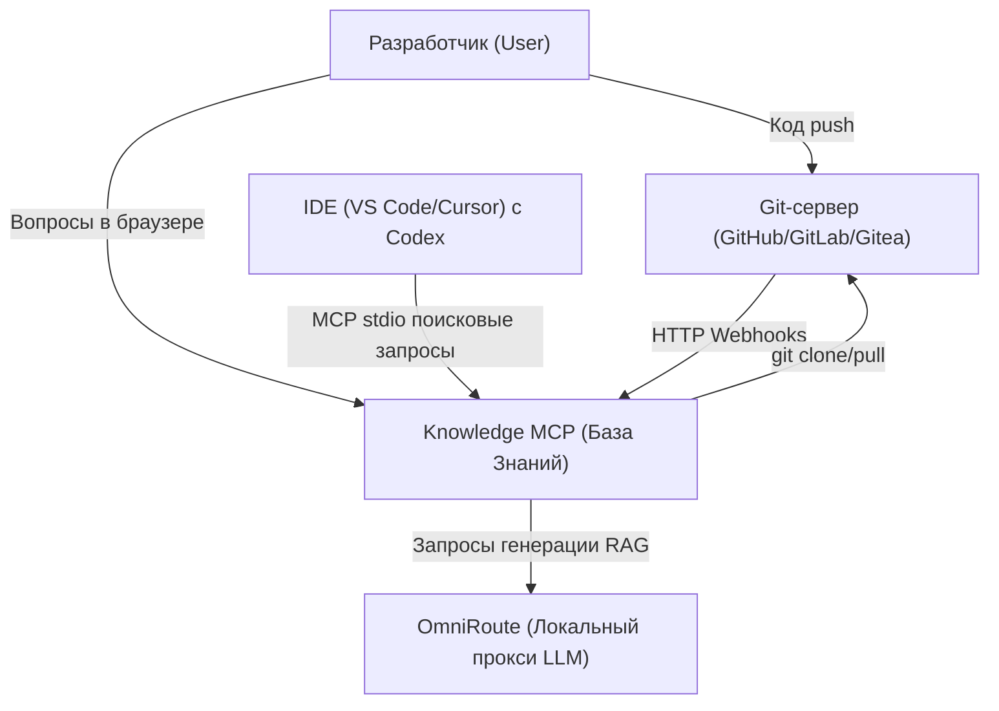
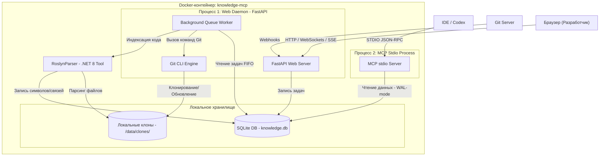
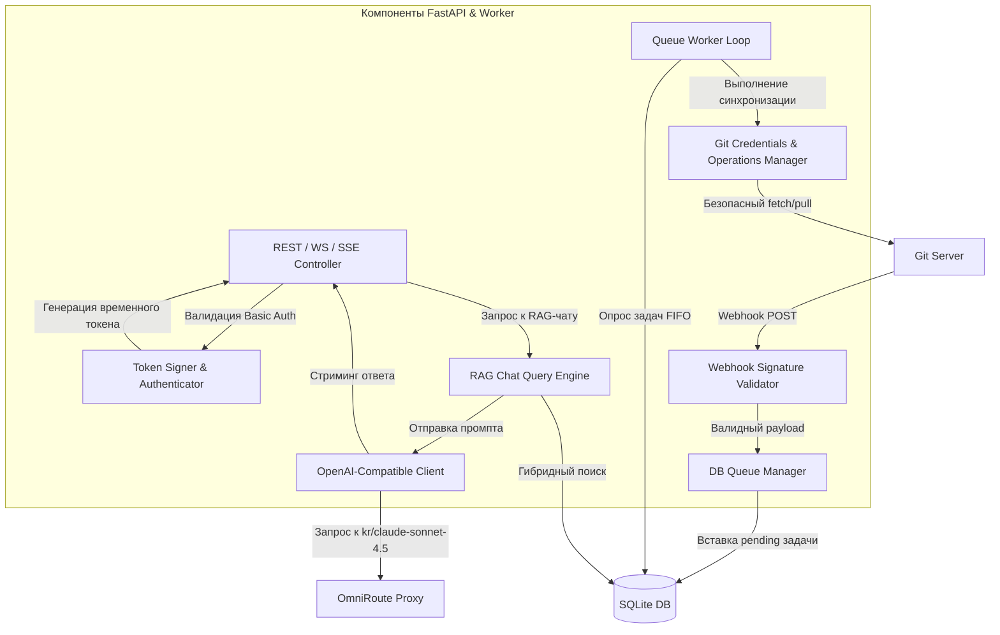

# Solution Design: Autonomous Sync & Dashboard Module (v1.3 - v1.6)

Этот документ содержит детальное техническое проектирование (Solution Design) модуля автономной синхронизации и веб-панели управления для `knowledge-mcp`. Проектирование выполнено по методологии **C4 Model** (Context, Containers, Components, Database).

---

## 1. C4 Diagrams

### C4 Level 1: Контекст системы (System Context)

Описывает место `knowledge-mcp` в общей экосистеме разработки.



---

### C4 Level 2: Контейнеры (Containers)

Детализирует структуру компонентов внутри Docker-контейнера `knowledge-mcp`.



---

### C4 Level 3: Компоненты Web Daemon (Components)

Детализирует логическую структуру фонового процесса Web Daemon.



---

## 2. Схема базы данных (Database Schema)

Для поддержки работы очереди и глобального статуса в базу данных SQLite добавляются две новые таблицы:

### 2.1. Таблица `sync_queue`
Используется для хранения очереди задач на синхронизацию.
```sql
CREATE TABLE IF NOT EXISTS sync_queue (
    id INTEGER PRIMARY KEY AUTOINCREMENT,
    repo_id TEXT NOT NULL,
    status TEXT NOT NULL CHECK(status IN ('pending', 'processing', 'completed', 'failed')),
    attempts INTEGER DEFAULT 0,
    error_message TEXT,
    created_at DATETIME DEFAULT CURRENT_TIMESTAMP,
    updated_at DATETIME DEFAULT CURRENT_TIMESTAMP
);

CREATE INDEX IF NOT EXISTS idx_queue_status_created ON sync_queue(status, created_at);
```

### 2.2. Таблица `system_status`
Используется для хранения глобального состояния воркера и ошибок.
```sql
CREATE TABLE IF NOT EXISTS system_status (
    key TEXT PRIMARY KEY,
    value TEXT NOT NULL,
    updated_at DATETIME DEFAULT CURRENT_TIMESTAMP
);
```
*Стандартные ключи:*
- `worker_state`: Текущий режим работы (`idle` | `syncing` | `halted`).
- `last_error`: Описание ошибки, остановившей воркер (если `worker_state = halted`).

---

## 3. Алгоритмы и безопасность

### 3.1. Алгоритм безопасного взаимодействия с Git (PAT / SSH)
Для предотвращения записи токенов на диск в `.git/config`:
1. При поступлении задачи Git-менеджер извлекает токен из переменной окружения, имя которой указано в `config.yaml`.
2. Выполняется кодирование токена в формат Base64: `auth_header = base64(x-token-auth:token)`.
3. Команда обновления Git запускается с динамическим заголовком авторизации:
   ```bash
   git -c http.extraHeader="Authorization: Basic <auth_header>" fetch --all
   git checkout <branch>
   git reset --hard origin/<branch>
   ```
4. Для SSH: Git-менеджер запускает команду с подменой SSH-агента:
   ```bash
   git -c core.sshCommand="ssh -i /path/to/key -o StrictHostKeyChecking=no" fetch --all
   ```

### 3.2. Алгоритм обработки очереди задач и экспоненциального бэк-оффа
1. Воркер запускается в бесконечном цикле `while True` с интервалом проверки БД в 1 секунду.
2. Перед выборкой задачи воркер проверяет таблицу `system_status`. Если `worker_state = halted`, обработка приостанавливается, воркер спит.
3. Воркер выбирает одну задачу:
   ```sql
   SELECT * FROM sync_queue WHERE status = 'pending' ORDER BY created_at ASC LIMIT 1;
   ```
4. Если задача найдена:
   - Обновляет её статус: `status = 'processing'`.
   - Проверяет идемпотентность (совпадает ли текущий коммит репозитория с записанным в базе `files.hash` для этого репозитория). Если совпадает — сразу переводит в `completed`.
   - Если SHA изменился, запускает Git Sync и индексер.
5. При ошибке:
   - Если `attempts < 3`, увеличивает счетчик попыток на 1, переводит статус обратно в `pending` и планирует запуск следующей попытки с задержкой:
     - Попытка 1: через 1 минуту.
     - Попытка 2: через 5 минут.
     - Попытка 3: через 15 минут.
   - Если `attempts >= 3`, переводит задачу в статус `failed`, сохраняет ошибку в `error_message`, записывает `worker_state = halted` и `last_error` в таблицу `system_status`. Воркер останавливается.
