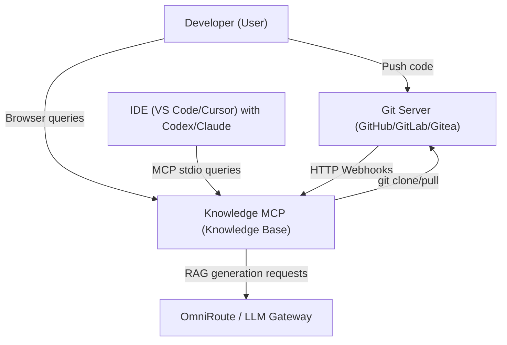
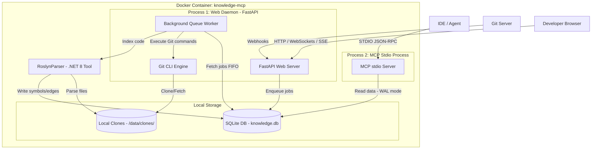
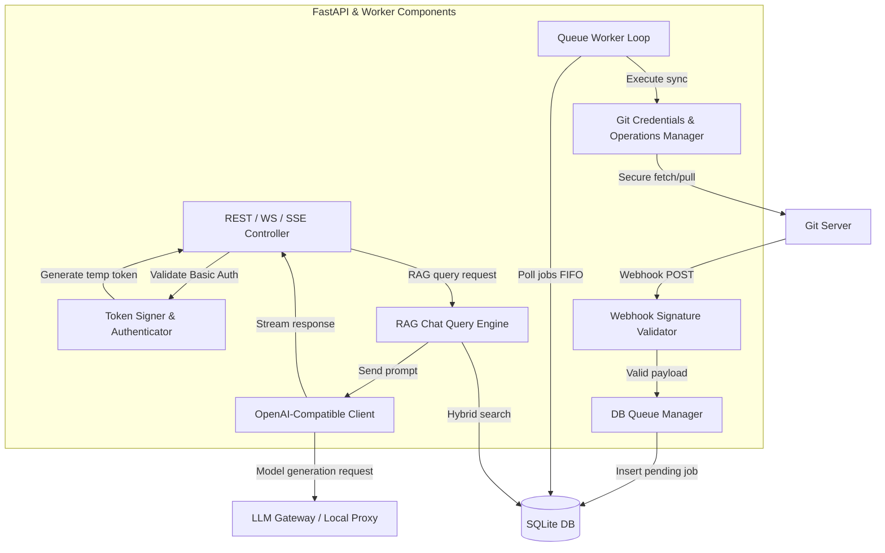

# Solution Design: Autonomous Sync & Dashboard Module (v1.3 - v1.6)

This document provides the detailed technical design (Solution Design) for the autonomous synchronization and Web UI Dashboard module for `knowledge-mcp`. The design follows the **C4 Model** (Context, Containers, Components, Database).

---

## 1. C4 Diagrams

### C4 Level 1: System Context

Describes the role of `knowledge-mcp` within the overall software engineering ecosystem.



---

### C4 Level 2: Containers

Details the component structure inside the `knowledge-mcp` Docker container.



---

### C4 Level 3: Web Daemon Components

Details the logical structure of the background Web Daemon process.



---

## 2. Database Schema

### 2.1. Table `sync_queue`
Stores the queue of pending and processed synchronization jobs.
```sql
CREATE TABLE IF NOT EXISTS sync_queue (
    id INTEGER PRIMARY KEY AUTOINCREMENT,
    repo_id TEXT NOT NULL,
    status TEXT NOT NULL CHECK(status IN ('pending', 'processing', 'completed', 'failed')),
    attempts INTEGER DEFAULT 0,
    error_message TEXT,
    created_at DATETIME DEFAULT CURRENT_TIMESTAMP,
    updated_at DATETIME DEFAULT CURRENT_TIMESTAMP
);

CREATE INDEX IF NOT EXISTS idx_queue_status_created ON sync_queue(status, created_at);
```

### 2.2. Table `system_status`
Persists the global operational state of the background worker and fatal error diagnostics.
```sql
CREATE TABLE IF NOT EXISTS system_status (
    key TEXT PRIMARY KEY,
    value TEXT NOT NULL,
    updated_at DATETIME DEFAULT CURRENT_TIMESTAMP
);
```
*Standard Keys:*
- `worker_state`: Operational state (`idle` | `syncing` | `halted`).
- `last_error`: Text description of fatal error halting the queue (when `worker_state = halted`).

---

### 2.3. Table `llm_profiles` (v1.9)
Stores LLM provider presets with ownership and sharing attributes.
```sql
CREATE TABLE IF NOT EXISTS llm_profiles (
    id TEXT PRIMARY KEY,
    owner_user TEXT NOT NULL DEFAULT 'admin',
    name TEXT NOT NULL,
    protocol TEXT NOT NULL DEFAULT 'openai_chat', -- openai_chat, ollama
    api_base TEXT NOT NULL,
    model TEXT NOT NULL,
    api_key_masked TEXT,
    is_shared BOOLEAN NOT NULL DEFAULT 1,
    settings_json TEXT,
    created_at DATETIME DEFAULT CURRENT_TIMESTAMP,
    updated_at DATETIME DEFAULT CURRENT_TIMESTAMP
);
```

### 2.4. Table `users` (v1.10)
Stores user accounts for multi-user access and role-based access control (RBAC).
```sql
CREATE TABLE IF NOT EXISTS users (
    id TEXT PRIMARY KEY,
    username TEXT UNIQUE NOT NULL,
    password_hash TEXT NOT NULL,
    role TEXT NOT NULL CHECK(role IN ('admin', 'developer', 'viewer')),
    is_active BOOLEAN NOT NULL DEFAULT 1,
    preferences_json TEXT,
    created_at DATETIME DEFAULT CURRENT_TIMESTAMP,
    updated_at DATETIME DEFAULT CURRENT_TIMESTAMP
);
```

---

## 3. Algorithms & Security

### 3.1. In-Memory Git Credential Isolation (PAT / SSH)
To prevent persisting credentials into `.git/config` on disk:
1. When a job begins, the Git manager resolves the token from the environment variable named in `config.yaml`.
2. Encodes the token to Base64: `auth_header = base64(x-token-auth:token)`.
3. The Git command executes with dynamic in-memory headers:
   ```bash
   git -c http.extraHeader="Authorization: Basic <auth_header>" fetch --all
   git checkout <branch>
   git reset --hard origin/<branch>
   ```
4. For SSH: executes with temporary key redirection:
   ```bash
   git -c core.sshCommand="ssh -i /path/to/key -o StrictHostKeyChecking=no" fetch --all
   ```

### 3.2. FIFO Worker Queue Loop & Exponential Backoff
1. The background worker loops with a 1-second polling interval against SQLite.
2. Checks `system_status`: if `worker_state = halted`, processing pauses.
3. Selects the oldest pending task:
   ```sql
   SELECT * FROM sync_queue WHERE status = 'pending' ORDER BY created_at ASC LIMIT 1;
   ```
4. If found:
   - Sets `status = 'processing'`.
   - Checks Git SHA idempotency against the stored hash for this repository. If matching, immediately transitions to `completed`.
   - If changed, triggers Git fetch/pull and AST re-indexing.
5. On error:
   - If `attempts < 3`, increments `attempts` by 1, transitions back to `pending`, and schedules a delayed retry:
     - Retry 1: after 1 minute.
     - Retry 2: after 5 minutes.
     - Retry 3: after 15 minutes.
   - If `attempts >= 3`, transitions to `failed`, saves `error_message`, writes `worker_state = halted` and `last_error` to `system_status`. The worker halts.

### 3.3. LLM Protocol Adaptation & Profile Management (v1.9)
1. User or administrator configures a profile via Dashboard Settings.
2. For local endpoints (e.g., `http://localhost:11434/v1` or `http://host.docker.internal:11434`), empty API keys (`api_key = null`) are permitted without validation errors.
3. Before persistence, an active connection ping verifies latency and time-to-first-token (TTFT).
4. Persists the profile tagged with session `owner_user` and `is_shared` visibility.

### 3.4. Multi-User Isolation & RBAC Architecture (v1.10)
1. Authentication validates Argon2id password hashes and issues HTTP-only session JWT tokens.
2. Role matrix:
   - `Admin`: full access to all repositories, Git token configurations, user role management, and global provider profiles (`is_shared = 1`).
   - `Developer`: RAG search over permitted workspaces, triggering manual syncs, managing personal private LLM profiles.
   - `Viewer`: read-only documentation inspection and RAG queries without configuration mutation privileges.
3. Conversation histories and personal preference records are partitioned by `user_id`.
