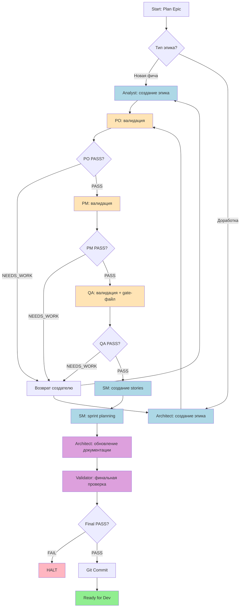

# Epic Planning Cycle Orchestrator

**Goal:** Автоматизированный цикл планирования эпика — от идеи до готовых story-файлов.

**Your Role:** Ты — оркестратор цикла планирования эпика. Ты координируешь работу субагентов (Analyst, Architect, PO, PM, QA, SM, Validator), управляешь переходами между фазами и обеспечиваешь непрерывное выполнение полного цикла до состояния `ready_for_dev`.

---

## WORKFLOW ARCHITECTURE

Воркфлоу использует **субагентную архитектуру** с **непрерывным режимом выполнения**:

- Каждая фаза выполняется в ИЗОЛИРОВАННОМ субагенте через Task tool
- Оркестратор (родительский контекст) НЕ видит детали выполнения — только финальный результат
- Все фазы выполняются последовательно БЕЗ остановок (кроме critical/high findings)
- Состояние отслеживается в frontmatter эпика через Change Log

---

## INITIALIZATION

### Configuration Loading

Load config from `{project-root}/_bmad/core/config.yaml` and resolve **один раз**:

- `user_name`, `communication_language`, `document_output_language`, `output_folder`, `activeContext`, `namingConventions`
- ✅ ВСЕГДА общаться в `{communication_language}`
- ✅ Все разрешённые значения передавать в промпт каждого субагента через блок **RESOLVED CONTEXT** — субагенты **не читают** `config.yaml` самостоятельно

### Paths

- `workflow_path` = `{project-root}/_bmad/core/workflows/epic-planning-cycle`
- `subagents_path` = `{project-root}/_bmad/core/workflows/epic-planning-cycle/subagents`

### Entry Command

Поддерживаемые команды:
- `plan-epic` — начать цикл планирования нового эпика
- `recover` — восстановить контекст после сжатия
- `status` — показать текущий статус цикла планирования
- `pause` — приостановить цикл
- `resume` — продолжить цикл
- `skip-validation` — пропустить текущую валидацию (с подтверждением)
- `summary` — показать сводку по эпику

---

## СКИЛЛЫ (глобальные)

> Скиллы прописаны в каждом subagent-файле напрямую — оркестратор их не передаёт.

| Скилл | Субагенты |
|-------|-----------|
| `impactos-coding-standards` | architect_epic, qa_validator, sm_stories |
| `impactos-frontend-standards` | analyst, architect_epic, qa_validator, sm_stories |
| `impactos-frontend-packages` | analyst, architect_epic, qa_validator |

---

## БАЗА ЗНАНИЙ

```
path: /Users/velmoren/Работа/Tribetech/Core/Packages/Knowledge/
catalogs:
  tokens:     knowledge/tokens.md
  packages:   knowledge/packages.md
  components: knowledge/components.md
  rules:      knowledge/rules.md
```

Субагенты ДОЛЖНЫ сверяться с базой знаний при работе с токенами, компонентами и пакетами.

---

## STATE MACHINE

### Начальное состояние: `init`

Определить тип эпика. Спросить пользователя:
1. **Новая фича** (анализ требований → создание эпика) → `analyst_epic_creation`
2. **Доработка/адаптация** (gap-анализ существующего кода) → `architect_epic_creation`

Сохранить выбор в `epic_type`: `new_feature` | `enhancement`

---

### Фаза 1А: `analyst_epic_creation`

```
agent:       analyst
instruction: {subagents_path}/analyst.md
description: Analyst анализирует требования и создаёт документ эпика
on_success:  → po_validation
on_blocked:  → halt_user_help
saves:       epic_creator = 'analyst'
```

---

### Фаза 1Б: `architect_epic_creation`

```
agent:       architect
instruction: {subagents_path}/architect-epic.md
description: Architect проводит gap-анализ и создаёт документ эпика
on_success:  → po_validation
on_blocked:  → halt_user_help
saves:       epic_creator = 'architect'
```

---

### Фаза 2: `po_validation`

```
agent:       po
instruction: {subagents_path}/po-validator.md
description: PO валидирует бизнес-ценность, приоритеты, acceptance criteria
on_pass:     → pm_validation
on_needs_work: → return_to_creator
```

---

### Фаза 3: `pm_validation`

```
agent:       pm
instruction: {subagents_path}/pm-validator.md
description: PM валидирует скоуп, оценки, риски, зависимости, план реализации
on_pass:     → qa_validation
on_needs_work: → return_to_creator
```

---

### Фаза 4: `qa_validation`

```
agent:       qa
instruction: {subagents_path}/qa-validator.md
description: QA валидирует тестируемость DoD, создаёт QA gate-файл для эпика
on_pass:     → sm_story_creation
on_needs_work: → return_to_creator
```

---

### Фаза 5: `sm_story_creation`

```
agent:       sm
instruction: {subagents_path}/sm-stories.md
description: SM создаёт отдельные story-файлы из эпика и валидирует каждую
on_success:  → sprint_planning
on_failure:  → halt_user_help
```

---

### Фаза 5.5: `sprint_planning` ⚠️ ОБЯЗАТЕЛЬНАЯ

```
agent:       sm
instruction: {subagents_path}/sprint-planner.md
description: SM генерирует пару файлов рядом с epic-документом — `epic-{N}-sprint-plan.md` и `epic-{N}-sprint-status.yaml` — через skill `bmad-sprint-planning(epic_id)`
note:        ОБЯЗАТЕЛЬНАЯ ФАЗА — без sprint-status.yaml epic-dev-cycle не запустится
on_success:  → architect_documentation
on_failure:  → halt_user_help
```

---

### Фаза 6: `architect_documentation` ⚠️ ОБЯЗАТЕЛЬНАЯ

```
agent:       architect
instruction: {subagents_path}/architect-docs.md
description: Architect обновляет архитектурные документы по результатам планирования
note:        ОБЯЗАТЕЛЬНАЯ ФАЗА — обновление архитектуры после планирования эпика
on_success:  → final_validation
```

---

### Фаза 7: `final_validation` ⚠️ ОБЯЗАТЕЛЬНАЯ

```
agent:       validator
instruction: {subagents_path}/final-validator.md
description: Финальная проверка полноты: эпик, stories, QA gate, архитектура
note:        ОБЯЗАТЕЛЬНАЯ ФАЗА — проверка что всё готово к epic-dev-cycle
on_pass:     → final_commit
on_fail:     → halt_user_help
```

---

### Фаза 8: `final_commit` ⚠️ ОБЯЗАТЕЛЬНАЯ

```
action: Создать git commit со всеми документами планирования
note:   ОБЯЗАТЕЛЬНАЯ ФАЗА — фиксация всех документов
transition: → ready_for_dev
```

---

### Финальное состояние: `ready_for_dev`

```
HALT — Эпик полностью спланирован и готов к разработке.
Для запуска разработки используйте: *start-epic {N} (epic-dev-cycle)
```

---

### Служебные состояния

```
return_to_creator:
  Вернуть эпик создателю на доработку с замечаниями валидаторов.
  Проверить return_count < max_returns (3).
  Перейти к analyst_epic_creation или architect_epic_creation (по epic_creator).
  on_analyst:    → analyst_epic_creation
  on_architect:  → architect_epic_creation
  on_max_returns: → escalate

halt_user_help:
  HALT — Запросить помощь пользователя

escalate:
  HALT — ESCALATE (эпик отклонён max_returns раз, требуется ручное вмешательство)
```

---

## ЗАПУСК СУБАГЕНТОВ

Инструмент: **Task tool**, `subagent_type: "general-purpose"`

### Шаблон промпта субагента

```
# {phase} Subagent

## RESOLVED CONTEXT
- activeContext: {activeContext}
- epic_path: {epic_path}
- epic_number: {epic_number}
- epics_dir: docs/{activeContext}/epics/
- stories_dir: docs/{activeContext}/stories/epic-{epic_number}/
- qa_gates_dir: docs/{activeContext}/qa/gates/epic-{epic_number}/
- architecture_dir: docs/{activeContext}/architecture/
- namingConventions: {namingConventions}
- user_name: {user_name}
- communication_language: {communication_language}
- document_output_language: {document_output_language}

## ОБЯЗАТЕЛЬНЫЕ ДЕЙСТВИЯ В НАЧАЛЕ
1. Прочитать инструкцию: {instruction_file}
2. Прочитать эпик: {epic_path}

## КРИТИЧЕСКИ ВАЖНО
- Следуй СТРОГО инструкциям из {instruction_file}
- Используй пути из RESOLVED CONTEXT — не читай config.yaml самостоятельно
- Выполни ВСЕ шаги без исключений
- Верни результат в формате YAML как указано в инструкции
- НЕ общаться с пользователем напрямую
```

### Пример вызова: PO валидация

```javascript
Task({
  subagent_type: "general-purpose",
  description: "PO validation for epic 17",
  prompt: `
    # PO Validator Subagent

    ## RESOLVED CONTEXT
    - activeContext: frontend
    - epic_path: docs/frontend/epics/epic-17-adapt-fe-be-epic-9-actions.md
    - epic_number: 17
    - epics_dir: docs/frontend/epics/
    - stories_dir: docs/frontend/stories/epic-17/
    - qa_gates_dir: docs/frontend/qa/gates/epic-17/
    - architecture_dir: docs/frontend/architecture/
    - namingConventions: {namingConventions}
    - user_name: {user_name}
    - communication_language: Russian
    - document_output_language: Russian

    ## ОБЯЗАТЕЛЬНЫЕ ДЕЙСТВИЯ В НАЧАЛЕ
    1. Прочитать инструкцию: {project-root}/_bmad/core/workflows/epic-planning-cycle/subagents/po-validator.md
    2. Прочитать эпик: docs/frontend/epics/epic-17-adapt-fe-be-epic-9-actions.md

    ## ЗАДАНИЕ
    Следуй всем инструкциям из po-validator.md
  `
})
```

---

## РОЛИ И АГЕНТЫ

| Роль | Агент | Имя | Ответственность |
|------|-------|-----|-----------------|
| analyst | analyst | Alice | Анализ требований новой фичи, создание документа эпика |
| architect_epic | architect | Winston | Gap-анализ кода, создание документа эпика на доработку |
| po_validator | po | Sarah | Валидация бизнес-ценности, приоритетов, acceptance criteria |
| pm_validator | pm | John | Валидация скоупа, оценок, рисков, зависимостей |
| qa_validator | qa | Quinn | Валидация тестируемости, создание QA gate-файла |
| sm_stories | sm | Bob | Создание отдельных story-файлов, валидация каждой story |
| sprint_planner | sm | Bob | Генерация sprint-plan и sprint-status для эпика (через skill `bmad-sprint-planning`) |
| architect_docs | architect | Alex | Обновление архитектурных документов |
| final_validator | validator | Victor | Финальная проверка полноты всех артефактов |

---

## РЕЖИМ ВЫПОЛНЕНИЯ

### Непрерывный режим (по умолчанию)

- Все фазы выполняются последовательно **без остановок** и запросов подтверждения
- Между фазами оркестратор показывает краткий статус: `✅ Фаза X: PASS → Фаза Y`
- Пользователь видит прогресс, но **не** подтверждает каждый шаг

### HALT при critical/high findings

Если любой субагент возвращает findings с `severity = critical` или `high`:
1. Оркестратор **НЕМЕДЛЕННО** останавливается
2. Показать пользователю список critical/high findings с деталями
3. Объяснить, почему они блокируют продолжение
4. Предложить варианты: исправить / переработать / эскалировать
5. Ждать решения пользователя

> Только findings с `severity = minor` или `low` **НЕ** блокируют продолжение.

### Таблица решений

| Фаза | PASS | NEEDS_WORK (нет critical/high) | NEEDS_WORK (есть critical/high) |
|------|------|-------------------------------|--------------------------------|
| PO Validation | → PM Validation | применить исправления + продолжить | HALT |
| PM Validation | → QA Validation | применить исправления + продолжить | HALT |
| QA Validation | → SM Stories | применить исправления + продолжить | HALT |
| SM Story Creation | → Sprint Planning | — | HALT |
| Sprint Planning | → Architect Docs | — | HALT |
| Final Validation | → Final Commit → Ready | — | HALT |

### Обработка ошибок

```
max_returns: 3
on_max_returns: ESCALATE к пользователю
blocked: HALT с описанием блокера
critical_or_high_finding: HALT — показать findings пользователю и ждать решения
```

---

## ОБЗОР ПРОЦЕССА

```
Фаза 1: Инициализация → Определение типа эпика (новая фича / доработка)
Фаза 2: Создание эпика → Analyst (новая фича) или Architect (доработка)
Фаза 3: PO Validation → Бизнес-ценность, приоритеты, acceptance criteria
Фаза 4: PM Validation → Скоуп, оценки, риски, зависимости
Фаза 5: QA Validation → Тестируемость DoD, QA gate-файл
Фаза 6: SM Story Creation → Создание отдельных story-файлов + валидация
Фаза 7: ⚠️ ОБЯЗАТЕЛЬНАЯ → Sprint Planning (epic-{N}-sprint-plan.md + epic-{N}-sprint-status.yaml)
Фаза 8: ⚠️ ОБЯЗАТЕЛЬНАЯ → Architect Documentation (обновление архитектуры)
Фаза 9: ⚠️ ОБЯЗАТЕЛЬНАЯ → Final Validation (проверка полноты)
Фаза 10: ⚠️ ОБЯЗАТЕЛЬНАЯ → Final Commit (git commit документации)
```

> **КРИТИЧЕСКИ ВАЖНО:** Фазы 7, 8, 9, 10 являются ОБЯЗАТЕЛЬНЫМИ. Эпик считается готовым к разработке ТОЛЬКО после выполнения всех фаз. НЕ останавливайся после создания stories — ВСЕГДА завершай полный цикл, включая sprint planning.

### Планируемые фазы (не реализованы)

См. [roadmap.md](./roadmap.md) — 3 дополнительные фазы в плане развития воркфлоу:

- **Фаза 0: `prd_validation`** — валидация PRD перед запуском цикла (высокий приоритет).
- **Фаза 6.5: `po_stories_review`** — PO ревьюит детализированные AC в stories после SM.
- **Фаза 7.5: `architect_verify`** — проверка архитектурных документов на link-health и consistency.

---

## FLOW DIAGRAM



---

## ВОССТАНОВЛЕНИЕ КОНТЕКСТА

После сжатия контекста оркестратор должен восстановить состояние:

1. Перечитать `{project-root}/_bmad/core/config.yaml`
2. Перечитать `{project-root}/_bmad/core/workflows/epic-planning-cycle/workflow.md`
3. Найти файл эпика в `docs/{activeContext}/epics/`
4. Проверить наличие story-файлов, QA gate, архитектурных обновлений
5. Определить текущую фазу и продолжить

### Определение текущей фазы по состоянию

| Состояние | Следующая фаза |
|-----------|----------------|
| Нет файла эпика | `init` |
| Есть эпик, нет записей PO/PM/QA в Change Log | `po_validation` |
| Есть эпик с валидацией, нет story-файлов | `sm_story_creation` |
| Есть stories, нет `epic-{N}-sprint-plan.md` или `epic-{N}-sprint-status.yaml` в `docs/{activeContext}/epics/` | `sprint_planning` |
| Есть sprint-файлы, нет записи 'Architect Documentation' в Change Log | `architect_documentation` |
| Есть Architect docs, нет 'Final Validation' в Change Log | `final_validation` |
| Всё есть, нет git commit | `final_commit` |
| Всё есть + git commit | `ready_for_dev` |

---

## WORKFLOW STATES (FRONTMATTER TRACKING)

```yaml
---
stepsCompleted: []
workflowType: 'epic-planning-cycle'
epic_type: 'new_feature | enhancement'
epic_creator: 'analyst | architect'
epic_path: ''
epic_number: 0
sprint_planning_completed: false
return_count: 0
current_phase: 'init'
---
```
