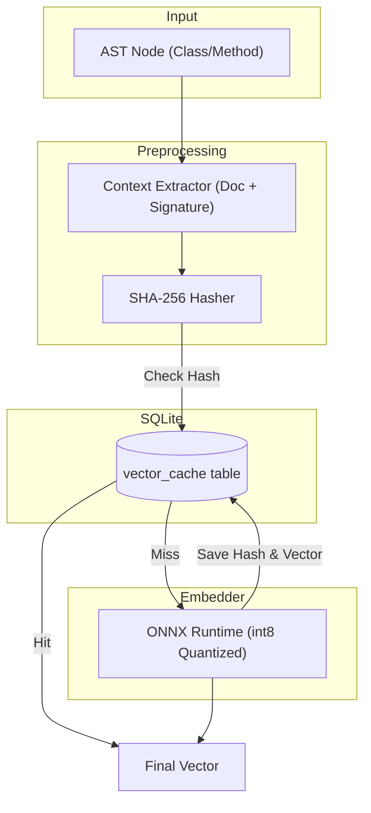

# ADR-003: Vectorization Performance Optimization

| Metadata | Value |
| :--- | :--- |
| **Status** | Proposed / Planned |
| **Date** | 2026-04-25 |
| **Author** | Antigravity / User |
| **Affects** | Indexer, LocalEmbedder, Knowledge DB |
| **Breaking Change** | No (backward compatible cache addition) |

---

## Context

The current vectorization pipeline for semantic search relies on standard CPU-based execution of Hugging Face models (e.g., `sentence-transformers`). While the hybrid search (ADR-002) significantly improved retrieval quality by combining FTS, Vector, and Graph search, the raw vectorization process remains a bottleneck during full codebase indexing or large updates. 

Currently, the system works as expected and stability is high, but there is substantial room for performance and quality improvements on CPU environments.

---

## Problem

1. **Redundant Vectorization:** Unchanged code fragments are re-embedded during indexing runs, wasting significant CPU cycles.
2. **Suboptimal CPU Utilization:** Standard PyTorch on CPU does not fully exploit hardware acceleration compared to optimized runtimes like ONNX.
3. **Thread Contention Risks:** Naive Python-level parallelization (e.g., `ThreadPoolExecutor`) for embedding can conflict with the underlying C++ matrix multiplication threads (intra-op parallelism), leading to slower execution.
4. **Poor Context for Code:** Embedding raw source code often yields suboptimal semantic vectors because lightweight models are trained primarily on natural language.

---

## Proposed Decision (Future Roadmap)

We plan to implement a multi-tiered optimization strategy for the vectorization pipeline:

### 1. Incremental Vectorization with SQLite Caching
- Introduce a local embedding cache within the existing SQLite database (e.g., `vector_cache` table containing `text_hash` and `vector_blob`).
- Before embedding any content, compute its hash. If a valid vector exists in the cache, retrieve it, bypassing the model entirely.
- This will provide an immediate 3x-10x speedup for repeated indexing of mostly unchanged repositories.

### 2. Hybrid Context Extraction
- Instead of feeding raw code blocks to the embedder, construct a structured "hybrid text" representation.
- Combine parsed `signature`, `documentation`, and `comments` into a single string with semantic tags (e.g., `[CLASS]`, `SIGNATURE:`).
- This aligns the code representation closer to natural language, drastically improving the relevance of vector search.

### 3. Engine Optimization: ONNX & Quantization
- Migrate the inference engine from pure PyTorch to **ONNX Runtime**.
- Apply **int8 quantization** to the `sentence-transformers/all-MiniLM-L6-v2` (or `intfloat/e5-small-v2`) model.
- Expected to yield a 2x-4x speedup on CPU inference with negligible loss in search accuracy.

### 4. Native Batching & Memory Management
- Remove any Python-level thread pools (`ThreadPoolExecutor`) wrapping the `model.encode()` calls.
- Rely strictly on native model batching (`model.encode(texts, batch_size=32)`).
- Ensure `normalize_embeddings=True` is used natively rather than applying post-processing PCA/Normalization, avoiding unnecessary overhead.

---

## Architecture Updates

---

## Status

**Proposed / Planned.** 
The system is currently stable and performant enough for existing workloads. These optimizations are documented as the roadmap for the next major version of the indexing pipeline to address future scaling needs.
