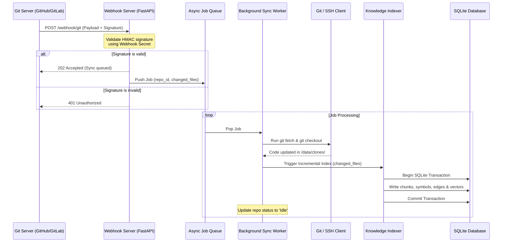

# ADR-004: Автономная фоновая синхронизация, триггеры и управление доступами

| Метаданные | Значение |
| :--- | :--- |
| **Статус** | Proposed |
| **Дата** | 2026-06-30 |
| **Автор** | Antigravity / User |
| **Влияет на** | Indexer, Webhook Server, Git Sync Manager, Credentials Storage |
| **Breaking Change** | Нет |

---

## Контекст

С переходом системы на автономную работу (начиная с версии `v1.3`), база знаний должна автоматически поддерживать свою актуальность без ручного вмешательства пользователя. Это требует интеграции с внешними Git-серверами через вебхуки и планировщик Cron, а также реализации механизмов безопасной работы с удаленными репозиториями, включая авторизацию по SSH и Personal Access Tokens (PAT).

Поскольку проект изначально спроектирован с упором на локальную работу в Docker, необходимо сохранить принципы безопасности, минимизации внешних зависимостей и изоляции данных.

---

## Проблема

1. **Доступ к приватному коду:** Для сканирования приватных репозиториев контейнеру требуются учетные данные (SSH-ключи или PAT). Хранить их внутри образа Docker небезопасно.
2. **Схема монтирования исходников:** Описанная в ADR-001 схема монтирования локальных папок хоста в режиме `read-only` несовместима с автоматическим обновлением по вебхукам, так как контейнер не имеет права изменять файлы на хост-машине.
3. **Безопасность входящих вебхуков:** Открытый HTTP-порт для вебхуков подвержен DoS-атакам и отправке поддельных событий. Требуется строгая криптографическая проверка подписей (HMAC-SHA256).
4. **Конкурентный доступ к БД:** Фоновое индексирование не должно блокировать поисковые запросы MCP-клиента к SQLite.

---

## Решение

### 1. Двухрежимная стратегия работы с исходным кодом
Система будет поддерживать два режима работы, настраиваемых для каждого репозитория индивидуально:
* **Режим "Mount" (Локальный):** Репозиторий примонтирован с хоста. Автономные триггеры (вебхуки, cron) для него отключены. Обновление индекса происходит по триггеру файловой системы (fsnotify/watchdog) или вручную через инструмент MCP.
* **Режим "Cloned" (Автономный удаленный):** Контейнер самостоятельно клонирует репозиторий из удаленного Git во внутреннюю writable-папку `/data/clones/{repo_id}`. Все операции `git pull`/`fetch` происходят внутри контейнера.

### 2. Безопасное управление учетными данными
* **SSH-авторизация:** Приватные ключи монтируются пользователем в контейнер при его запуске (например, в `/root/.ssh/id_rsa` или `/secrets/id_rsa`). В конфигурации `config.yaml` указывается путь к ключу. При выполнении Git-команд переопределяется переменная окружения `GIT_SSH_COMMAND="ssh -i /path/to/key -o StrictHostKeyChecking=no"`.
* **PAT-авторизация:** Токены передаются через переменные окружения контейнера (например, `GITHUB_PAT`). В `config.yaml` указывается имя переменной окружения, значение которой подставляется в URL клонирования на лету: `https://<token>@github.com/org/repo.git`. Это исключает жесткое кодирование токенов в конфигурационных файлах.

### 3. Криптографическая валидация вебхуков
Для защиты эндпоинта `/webhook/git`:
* **GitHub:** Валидация заголовка `X-Hub-Signature-256`. Вычисляется HMAC-SHA256 от тела запроса с использованием секретного ключа из переменной окружения.
* **GitLab:** Проверка токена в заголовке `X-Gitlab-Token` на точное соответствие эталону.
* Невалидные запросы отклоняются с кодом `401 Unauthorized` без передачи их в очередь обработки.

### 4. Фоновый планировщик и очередь задач (Scheduler & Queue)
* Бэкенд на FastAPI запускает фоновый процесс на базе библиотеки `APScheduler` или встроенного AsyncIO-цикла для обработки задач по расписанию (Cron).
* Очередь задач реализуется в оперативной памяти (на базе `asyncio.Queue`). Это гарантирует последовательное выполнение ресурсоемких задач индексирования (один поток записи в БД за раз), исключая перегрузку CPU и взаимные блокировки SQLite (Deadlocks).

---

## Архитектура процессов синхронизации

---

## Риски и их предотвращение

| Риск | Вероятность | Способ минимизации |
| :--- | :--- | :--- |
| **Утечка токенов через конфиг** | Средняя | Использование ссылок на переменные окружения (`token_env`) вместо записи самих токенов в `config.yaml`. |
| **Блокировка БД при чтении во время записи** | Высокая | Включение режима SQLite **WAL (Write-Ahead Logging)** в `db.py` для параллельного чтения без блокировок пишущим потоком. |
| **DoS-атака тяжелыми вебхуками** | Средняя | Валидация подписи на самом раннем этапе. Ограничение размера входящего JSON-пакета вебхука (max 5 MB). |
| **Накопление устаревших клонов** | Низкая | Механизм автоматической очистки папки `/data/clones/{repo_id}` при удалении репозитория через API или MCP-инструмент. |
