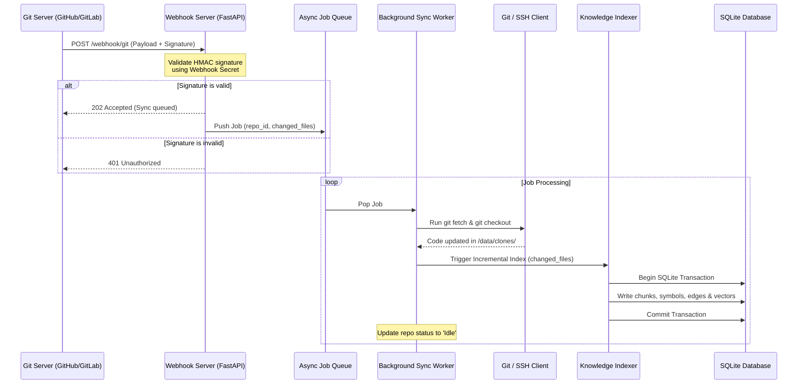

# ADR-004: Autonomous Background Sync, Triggers, and Credential Management

| Metadata | Value |
| :--- | :--- |
| **Status** | Accepted |
| **Date** | 2026-06-30 |
| **Author** | Antigravity / User |
| **Affects** | Indexer, Webhook Server, Git Sync Manager, Credentials Storage |
| **Breaking Change** | No |

---

## Context

With the system transitioning to autonomous operation (beginning with version `v1.3`), the knowledge base must automatically keep its index up to date without manual intervention. This requires integrating with remote Git servers via webhooks and scheduled Cron execution, alongside secure mechanisms for interacting with remote repositories, including SSH authentication and Personal Access Tokens (PAT).

Because the project was designed from the ground up for containerized local execution in Docker, core principles must be preserved: high security, minimal external dependencies, and local data isolation.

---

## Problem Statement

1. **Accessing Private Code:** Scanning private repositories requires credentials (SSH keys or PATs) inside the container. Storing credentials inside the Docker image is unacceptable.
2. **Source Code Mount Limitations:** The local host-directory mount scheme described in ADR-001 operates in `read-only` mode, which is incompatible with automated webhook updates since the container lacks write permissions to host-bound directories.
3. **Incoming Webhook Security:** An exposed HTTP port for webhooks is susceptible to DoS attacks and forged events. Strict cryptographic signature verification (HMAC-SHA256) is mandatory.
4. **Concurrent Database Access:** Background indexing must not lock SQLite database queries executed by concurrent MCP clients.

---

## Decision

### 1. Dual-Mode Source Code Strategy
The system supports two operating modes, configurable per repository:
* **"Mount" Mode (Local):** The repository is mounted directly from the host filesystem. Autonomous triggers (webhooks, cron) are disabled for this repository. Updates occur via filesystem events (`fsnotify`/`watchdog`) or on-demand via MCP tools.
* **"Cloned" Mode (Autonomous Remote):** The container clones the repository from remote Git into an internal writable directory: `/data/clones/{repo_id}`. All subsequent `git pull` and `fetch` operations occur inside the container volume.

### 2. Secure Credential Management
* **SSH Authentication:** Private keys are mounted into the container at startup by the user (e.g., `/root/.ssh/id_rsa` or `/secrets/id_rsa`). The path to the private key is referenced in `config.yaml`. Git commands dynamically inject `GIT_SSH_COMMAND="ssh -i /path/to/key -o StrictHostKeyChecking=no"`.
* **PAT Authentication:** Tokens are passed via container environment variables (e.g., `GITHUB_PAT`). In `config.yaml`, the environment variable name is referenced (`token_env`), and credentials are injected into the clone URL or request header in-memory: `https://<token>@github.com/org/repo.git`. Tokens are never written to disk in plain text.

### 3. Cryptographic Webhook Validation
To protect the `/webhook/git` endpoint:
* **GitHub / Gitea:** Validate the `X-Hub-Signature-256` (or `X-Gitea-Signature`) header by computing HMAC-SHA256 against the raw request body using the configured webhook secret.
* **GitLab:** Validate the `X-Gitlab-Token` header for an exact secret match.
* Invalid requests are immediately rejected with `401 Unauthorized` before entering the processing queue.

### 4. Background Scheduler and Job Queue
* A FastAPI daemon runs background workers using an async queue (`asyncio.Queue`) and periodic tasks via `APScheduler` or native AsyncIO loops for Cron schedules.
* Tasks are processed sequentially (one write transaction at a time), preventing CPU saturation and SQLite database write locks / deadlocks.

---

## Synchronization Architecture

---

## Risks and Mitigations

| Risk | Probability | Mitigation Strategy |
| :--- | :--- | :--- |
| **Token leakage via configuration files** | Medium | Use environment variable references (`token_env`) rather than committing raw tokens to `config.yaml`. |
| **Database lock during concurrent read/write** | High | Enable SQLite **WAL (Write-Ahead Logging)** mode via `PRAGMA journal_mode=WAL` and `synchronous=NORMAL` to allow concurrent non-blocking reads. |
| **DoS via oversized webhook payloads** | Medium | Early signature verification; enforce a strict payload size limit (max 5 MB). |
| **Stale clone accumulation on disk** | Low | Implement automated disk cleanup for `/data/clones/{repo_id}` whenever a repository is deleted via API or MCP tool. |
