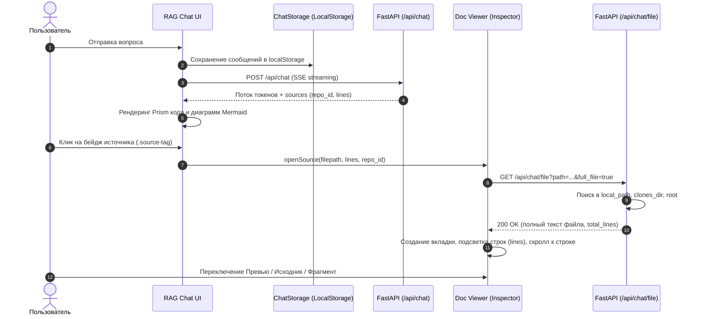

# ADR-007: Интерактивный инспектор документов, рендеринг Mermaid и форматирование RAG-чата

**Статус:** Принято  
**Дата:** 2026-10-21  
**Область:** Web Dashboard, RAG Chat, Doc Viewer, REST API  
**Связано с:** [ADR-005: Web Dashboard Architecture](adr-005-web-dashboard-architecture.md)

---

## 1. Контекст и проблематика

В версии v1.6 был реализован базовый веб-интерфейс RAG-чата с потоковым ответом (SSE). Однако в процессе реальной эксплуатации выявился ряд существенных ограничений взаимодействия с контекстом:

1. **Неработающие ссылки на источники (404 Not Found):**
   - В ответах ассистента выводились бейджи с путями к файлам (например, `docs/data-access/stories/epic-1/story-1.8.md (6-9)`), но при попытке их открыть возникала ошибка 404, либо ссылки не реагировали.
   - Эндпоинт `/api/chat/file` производил поиск файлов только в каталогах `data/clones` и корне репозитория сервера, игнорируя локально примонтированные репозитории (`local_path: "/repos/ImpactOS.Core.Lib"`), а также не передавал идентификатор репозитория `repo_id`.

2. **Отсутствие контекстного инспектора документов:**
   - Для проверки найденного фрагмента разработчику приходилось переключаться в стороннюю IDE и вручную искать файл и нужные строки.
   - Отсутствовала возможность держать открытыми несколько связанных файлов одновременно (например, класс сущности C# и соответствующую пользовательскую историю Markdown).

3. **Неформатированный вывод ответов бота:**
   - Блоки исходного кода отображались без плашек языка и без кнопки быстрого копирования в буфер обмена.
   - Диаграммы Mermaid в ответах ассистента оставались нерендеренным текстовым блоком ````mermaid ... ````.

4. **Потеря контекста диалога при перезагрузке:**
   - Чат очищался при каждом обновлении страницы браузера (F5), что вызывало неудобство при случайной перезагрузке или переключении вкладок браузера.

---

## 2. Принятые решения

### 2.1. Расширение бэкенда и резолв файлов (`/api/chat/file`)
- В ответ SSE и JSON-модели источников (`ChatSource`) добавлены поля:
  - `repo_id`: строковый идентификатор репозитория (например, `ImpactOS.Core.Lib`);
  - `line_start`, `line_end`: целочисленные границы цитируемого фрагмента.
- Реализована функция `get_configured_repo_roots(config)`, которая динамически собирает все возможные корневые директории:
  1. `local_path` каждого настроенного репозитория (включая Docker volume-пути `/repos/...`);
  2. Папки склонированных репозиториев в `clones_dir` (`data/clones/<repo_id>`);
  3. Корневую директорию проекта.
- В эндпоинт `GET /api/chat/file` добавлен параметр `full_file: bool = False`:
  - При `full_file=false` эндпоинт возвращает только запрошенный диапазон строк.
  - При `full_file=true` эндпоинт возвращает полный текст файла вместе с общим количеством строк (`total_lines`), что позволяет фронтенду отобразить весь файл целиком и подсветить нужные строки.

### 2.2. Архитектура разделителя (Resizable Splitter)
- Внедрен двухколоночный макет рабочей области чата:
  - **Левая колонка:** окно сообщений и ввод RAG-чата.
  - **Правая колонка:** панель инспектора документов (`app-doc-viewer`).
- Разделитель (`.split-resizer`):
  - По умолчанию панель документов занимает **45%** ширины контентного окна.
  - Поддерживает плавное перетаскивание мыши (`drag-to-resize`) с ограничением в диапазоне от 20% до 80%.
  - Двойной клик (`dblclick`) по разделителю мгновенно сбрасывает ширину до стандартных 45%.
  - Выбранная пропорция сохраняется в `localStorage['kb_chat_split_ratio']` и восстанавливается при перезагрузках.

### 2.3. Инспектор документов в стиле IDE (`DocViewerComponent`)
- **Многовкладочный интерфейс (IDE-style Tabs):**
  - Поддерживает одновременное открытие произвольного количества документов.
  - Каждая вкладка отображает бейдж типа файла (`MD`, `CS`, `TS`, `PY`), имя файла, диапазон цитируемых строк и кнопку закрытия `✕`.
  - Повторный клик на источник того же файла активирует существующую вкладку, обновляя целевой диапазон строк без перезагрузки.
  - Кнопка «Закрыть всё» скрывает панель инспектора и возвращает чат на 100% ширины.
- **Два режима отображения документа:**
  - `👁️ Превью` (для Markdown): рендеринг форматированного текста, заголовков, таблиц, чекбоксов и схем Mermaid.
  - `📝 Исходник`: сырой код с колонкой номеров строк (`.line-num`), моноширинным шрифтом JetBrains Mono и подсветкой синтаксиса через Prism.js.
- **Подсветка строк цитирования и автоскролл:**
  - Строки цитаты (например, 6–9) выделяются мягким фоном (`.code-line-row.line-highlight`).
  - При открытии файла компонент автоматически скроллит к первой строке диапазона (`scrollIntoView({ behavior: 'smooth', block: 'center' })`).
  - Переключатель `Весь файл / Фрагмент`: возможность изолированно просматривать только найденные строки цитаты.

### 2.4. Форматирование ответов ассистента и Mermaid
- Сервис `MarkdownService` на базе Marked и Prism.js:
  - Оборачивает блоки кода в контейнер `.code-block-wrapper` со стилизованной шапкой, плашкой языка (`C#`, `TypeScript`, `Python`, `SQL`, `Bash` и т.д.) и кнопкой копирования кода в буфер обмена.
  - Блоки ````mermaid```` оборачиваются в `.mermaid-block-wrapper` и асинхронно рендерятся в векторный SVG через ESM-модуль `mermaid` (`MermaidService`).
  - `MermaidService` динамически синхронизирует тему (`dark` / `default`) с текущей темой интерфейса (`ThemeService.isDarkMode()`). При ошибке синтаксиса диаграммы пользователю выводится читаемый баннер с описанием ошибки и исходным кодом.
- **Безопасность Angular DomSanitizer:**
  - Для предотвращения автоматического вырезания интерактивных кнопок (`<button class="btn-copy-code">`) санитайзером Angular используется метод `renderSafe()`, возвращающий `SafeHtml` через `sanitizer.bypassSecurityTrustHtml()`.

### 2.5. Хранение истории сообщений в браузере (`ChatStorageService`)
- История диалога сохраняется в `localStorage['kb_chat_history_v1']`.
- В шапке чата отображается бейдж активной памяти диалога.
- Добавлена кнопка «Новый диалог» (`btn-clear-chat`), позволяющая по подтверждению пользователя сбросить историю и вернуть чат в исходное приветственное состояние.

---

## 3. Схема взаимодействия компонентов



---

## 4. Последствия и преимущества

### Положительные:
1. **Бесшовный аудит контекста:** Разработчик сразу видит документ, на который ссылается нейросеть, с подсветкой точных строк цитаты и возможностью переключения между превью и кодом.
2. **Многозадачность (IDE-style):** Возможность держать открытыми несколько файлов одновременно на вкладках и быстро сравнивать их.
3. **Наглядность:** Архитектурные схемы и диаграммы классов Mermaid отображаются графически прямо в теле ответа.
4. **Сохранение контекста:** История диалога больше не сбрасывается при перезагрузке страницы.
5. **Эргономика интерфейса:** Удобный сплиттер позволяет подстроить ширину панели под размер монитора пользователя с быстрым сбросом на 45%.

### Ограничения:
1. История диалога хранится локально в `localStorage` конкретного браузера, а не на сервере (соответствует инварианту AD-3 о stateless-бэкенде).
2. Для очень больших текстовых файлов (>10 000 строк) рекомендуется использовать режим просмотра фрагмента для снижения нагрузки на DOM.
