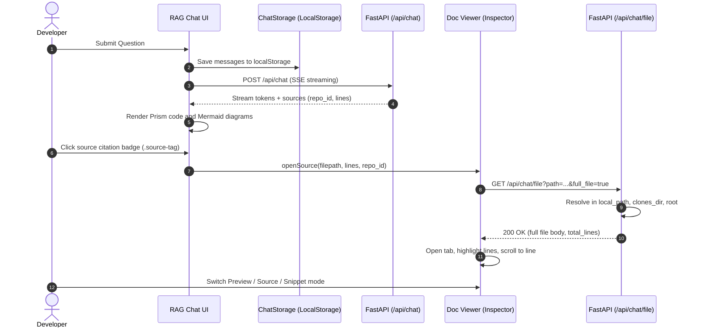

# ADR-007: Interactive Document Inspector, Mermaid Diagramming, and RAG Chat Formatting

| Metadata | Value |
| :--- | :--- |
| **Status** | Accepted |
| **Date** | 2026-10-21 |
| **Affects** | Web Dashboard, RAG Chat, Doc Viewer, REST API |
| **Related To** | [ADR-005: Web Dashboard Architecture](adr-005-web-dashboard-architecture.md) |
| **Breaking Change** | No |

---

## 1. Context and Problem Statement

Milestone `v1.6` introduced a baseline RAG chat interface with Server-Sent Events (SSE) streaming. Real-world developer usage revealed several critical UX and context inspection bottlenecks:

1. **Broken Source Citations (404 Not Found):**
   - Assistant responses included source badges referencing file paths (e.g., `docs/data-access/stories/epic-1/story-1.8.md (6-9)`), but clicking them yielded 404 errors or failed to trigger navigation.
   - The backend `/api/chat/file` endpoint resolved files exclusively inside `data/clones` and the project root, failing to discover locally mounted repository paths (`local_path: "/repos/ImpactOS.Core.Lib"`) and omitting repository identifier metadata (`repo_id`).

2. **Absence of an In-Context Document Inspector:**
   - To verify cited code snippets, developers had to switch to an external IDE and manually locate the file and target line numbers.
   - There was no support for keeping multiple related documents open concurrently (e.g., a C# domain entity and its corresponding Markdown story specification).

3. **Unformatted Assistant Responses:**
   - Source code blocks lacked programming language badges and one-click copy buttons.
   - Mermaid diagram blocks within assistant replies remained raw unrendered text fences (````mermaid ... ````).

4. **Loss of Dialogue Context on Page Reload:**
   - Conversation state was cleared on every browser refresh (F5), degrading the developer experience during accidental refreshes or tab switches.

---

## 2. Decision

### 2.1. Backend Path Resolution Expansion (`/api/chat/file`)
- Extended SSE citation events and the `ChatSource` data contract with:
  - `repo_id`: string repository identifier (e.g., `ImpactOS.Core.Lib`);
  - `line_start`, `line_end`: integer boundaries of the cited code chunk.
- Implemented `get_configured_repo_roots(config)` to dynamically aggregate all configured repository roots:
  1. `local_path` for every configured repository (including container volume paths `/repos/...`);
  2. Cloned repository directories in `clones_dir` (`data/clones/<repo_id>`);
  3. The local server root directory.
- Added `full_file: bool = False` query parameter to `GET /api/chat/file`:
  - When `full_file=false`, the endpoint returns only the cited line range.
  - When `full_file=true`, the endpoint returns the complete file body along with `total_lines`, allowing the frontend to render the whole file with highlighted citation lines.

### 2.2. Resizable Splitter Architecture
- Implemented a dual-column layout for the chat workspace:
  - **Left column:** message feed and RAG chat input.
  - **Right column:** document inspector panel (`app-doc-viewer`).
- Splitter behavior (`.split-resizer`):
  - Defaults to **45%** width for the document inspector panel.
  - Supports smooth drag-to-resize clamped between 20% and 80%.
  - Double-clicking (`dblclick`) resets the width to the default 45%.
  - Selected ratio persists in `localStorage['kb_chat_split_ratio']` across browser sessions.

### 2.3. IDE-Style Document Inspector (`DocViewerComponent`)
- **IDE-style Tabbed Interface:**
  - Supports multiple simultaneously opened documents.
  - Each tab displays a language badge (`MD`, `CS`, `TS`, `PY`), filename, cited line range, and a close button (`✕`).
  - Clicking a citation for an already open document switches to that tab and updates the highlighted line range without reloading.
  - "Close All" button dismisses the inspector and restores the chat panel to 100% width.
- **Dual Display Modes:**
  - `👁️ Preview` (for Markdown): renders formatted headings, tables, task lists, and inline Mermaid diagrams.
  - `📝 Raw Source`: raw code display with line numbers (`.line-num`), JetBrains Mono monospace typography, and syntax highlighting via Prism.js.
- **Line Highlighting and Smooth Auto-Scroll:**
  - Cited lines (e.g., lines 6–9) are highlighted with a prominent background (`.code-line-row.line-highlight`).
  - Opening a file smoothly auto-scrolls to the first cited line (`scrollIntoView({ behavior: 'smooth', block: 'center' })`).
  - Toggle between `Full File` and `Snippet Only` modes.

### 2.4. Assistant Response Formatting and Mermaid SVG
- Integrated `MarkdownService` using Marked and Prism.js:
  - Wraps code blocks inside `.code-block-wrapper` with a header bar, language label (`C#`, `TypeScript`, `Python`, `SQL`, `Bash`), and a one-click clipboard copy button.
  - Fenced ````mermaid```` blocks are wrapped in `.mermaid-block-wrapper` and asynchronously rendered into SVG using the ESM `mermaid` module (`MermaidService`).
  - `MermaidService` dynamically synchronizes themes (`dark` / `default`) with the application theme state (`ThemeService.isDarkMode()`). Syntax errors render a graceful warning banner with the underlying source.
- **Angular DomSanitizer Safety:**
  - Interactive buttons (`<button class="btn-copy-code">`) are preserved by returning `SafeHtml` via `sanitizer.bypassSecurityTrustHtml()`.

### 2.5. Client-Side Dialogue Storage (`ChatStorageService`)
- Conversation history persists in `localStorage['kb_chat_history_v1']`.
- The chat header displays a badge indicating stored dialogue memory.
- A "New Dialog" action (`btn-clear-chat`) prompts for confirmation, clears local storage, and resets the chat to the initial welcome state.

---

## 3. Component Interaction Flow



---

## 4. Consequences and Benefits

### Positive:
1. **Frictionless Context Auditing:** Developers instantly view cited documents with precise line highlighting without leaving the dashboard.
2. **IDE-Style Multitasking:** Multiple tabs can remain open simultaneously to compare interface contracts, tests, and implementations.
3. **Rich Visualizations:** Mermaid architecture and sequence diagrams render directly inline within LLM answers.
4. **Dialogue Resilience:** Chat history survives browser reloads and tab closures.
5. **Ergonomic Workspace:** Resizable splitter accommodates varying monitor sizes and multi-monitor setups.

### Trade-offs:
1. Conversation history lives in client-side `localStorage` rather than server database (adheres to the stateless backend invariant AD-3).
2. For exceptionally large files (>10,000 lines), snippet mode is recommended to minimize DOM node overhead.
