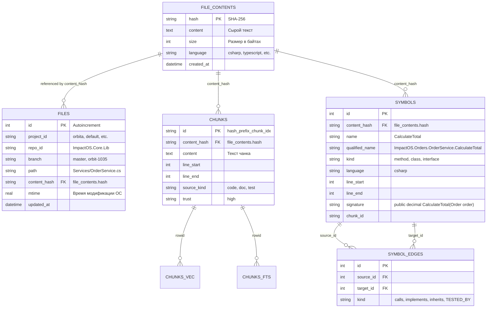
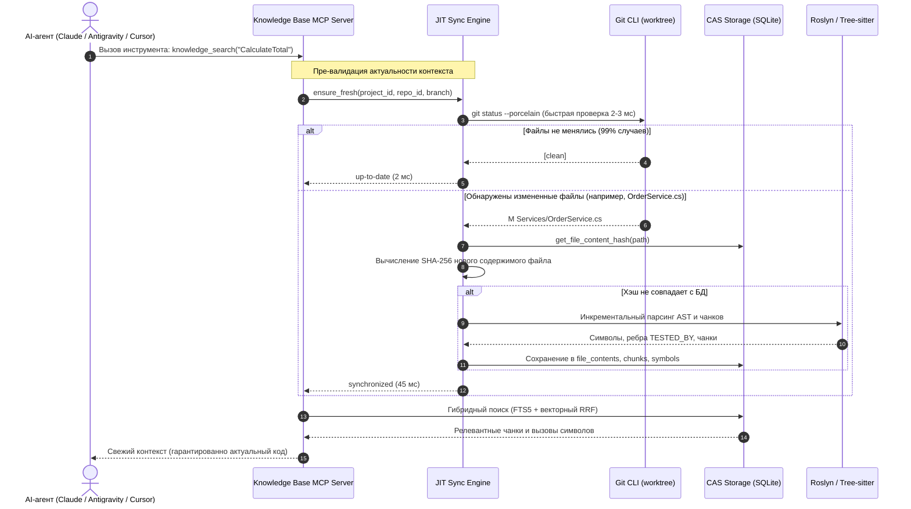

# ADR-008: Архитектура Multi-Worktree, CAS-дедупликация контента и гибридная синхронизация для AI-агентов

**Статус:** Принято (Accepted)  
**Дата:** 2026-10-23  
**Область:** Core Engine, Data Layer (SQLite CAS), Sync Engine (JIT + Watcher + Hooks), Code Review Graph, Institutional Memory, Target Agent Adapters, Web UI Dashboard  
**Связано с:** 
- [ADR-001: Локальная RAG-база знаний MCP](adr-001-local-mcp-rag-knowledge-base.md)
- [ADR-002: Гибридная семантическая и графовая индексация](adr-002-hybrid-semantic-graph-indexing.md)
- [ADR-004: Автономная синхронизация, триггеры и управление секретами](adr-004-autonomous-sync-triggers-credentials.md)
- [ADR-005: Архитектура панели управления Web Dashboard](adr-005-web-dashboard-architecture.md)
- [ADR-006: Внешние таблицы FTS5 и оптимизация дискового пространства](adr-006-fts5-external-content-and-large-repo-batching.md)
- [ADR-007: Интерактивный инспектор документов и форматирование RAG-чата](adr-007-interactive-chat-doc-inspector-and-mermaid.md)

---

## 1. Контекст и проблематика

### 1.1. Мульти-репозиторные воркспейсы и паттерн Git Worktree
При разработке сложных распределенных систем (например, паттерн enterprise-воркспейса `C:\Repos\DVCN\Orbita`) инженеры и AI-агенты работают не с одним локальным клоном, а со структурой связанных репозиториев и множественных рабочих деревьев Git (**Git Worktrees**):
- Базовая ветка: `worktrees/master`
- Рабочие деревья параллельных задач: `worktrees/orbit-1035`, `worktrees/orbit-1042`, `worktrees/hotfix-auth` и т.д.

Все эти рабочие деревья делят общий физический каталог объектов `.git`, но представляют собой независимые рабочие директории в файловой системе.

### 1.2. Катастрофическое раздувание диска в существующих решениях (Кейс `code-review-graph`)
Предыдущие попытки решения задачи индексации много-ветвенных воркспейсов (в частности, инструмент `code-review-graph`, CRG) базировались на изоляции баз данных: под каждый отдельный ворктри создавался локальный каталог `.code-review-graph/` с персональной базой SQLite и векторным индексом.

Это привело к критическим проблемам эксплуатации:
1. **Раздувание диска до 7–10 ГБ:** В активном воркспейсе ветки задач отличаются от `master` всего на 1–3% файлов. При изолированном подходе 97–99% неизменных файлов, AST-деревьев символов, полнотекстовых индексов FTS5 и векторных эмбеддингов эмбеддинг-модели E5 дублировались для каждого ворктри заново. Для группы из 5–8 ворктри объем дискового пространства превышал 7 ГБ.
2. **Колоссальный перерасход CPU/RAM:** При переключении или создании нового ворктри запускалась полная переиндексация гигабайтов неизменного исходного кода, нагружая процессор и сжигая ресурсы машины разработчика.
3. **Фрагментация дискового кэша:** Векторные эмбеддинги одинаковых функций рассчитывались повторно десятки раз.

### 1.3. Требование Zero-Footprint в репозиториях заказчика
Корпоративные политики безопасности и правила гигиены кодовой базы заказчиков категорически запрещают загрязнять рабочие деревья Git сторонними служебными директориями (`.knowledgebase/`, `.crg/`, локальными `.db` файлами или конфигурациями AI-агентов).
- Вся база знаний, графы символов и индексы должны храниться **централизованно** на стороне сервера Knowledge Base MCP (каталог `data/`).
- В репозиториях заказчика обеспечивается абсолютный **Zero-Footprint** (нулевой след в файловой системе и Git-истории).

### 1.4. Проблема рассинхронизации контекста агентов (Stale Context)
AI-агенты нового поколения (**Claude Code**, **Antigravity**, **Cursor**, **Codex**) модифицируют код в рабочих деревьях непрерывно. Классический подход с периодическим опросом (Cron каждые 5 минут) или вебхуками Git неприменим:
- Агент изменяет сигнатуру метода через инструмент редактирования (`Edit`/`Write`).
- Через 1–2 секунды агент вызывает `knowledge_get_callers` или `knowledge_search`.
- Если база еще не обновилась, агент получает устаревший контекст (Stale Context), что приводит к ошибочным решениям и галлюцинациям.
- Использование только файловых вотчеров (File Watchers) не дает 100% гарантии: события могут теряться при пиковых I/O нагрузках или задерживаться очередью обработки.

---

## 2. Принятые решения

### 2.1. Контентно-адресуемое хранилище (Content-Addressable Storage, CAS)
Архитектура хранения полностью разделяет **логическое размещение файла** в проекте/ворктри и его **физическое содержимое**.



#### Принцип работы CAS:
1. Таблица `file_contents` является единственным источником истины для содержимого файлов:
   - Первичный ключ `hash TEXT` — криптографический хэш SHA-256.
2. Таблица `files` содержит легковесные ссылки с уникальным композитным индексом:
   - `UNIQUE(project_id, repo_id, branch, path)`.
3. Таблицы `chunks`, `symbols`, `chunks_vec` (векторные эмбеддинги) и `chunks_fts` (полнотекстовый поиск) ссылаются напрямую на `content_hash`.
4. **Результат дедупликации:** Если 98% файлов между `worktrees/master` и `worktrees/orbit-1035` совпадают по содержимому, они ссылаются на одни и те же записи в `file_contents`. База данных SQLite для 10 ворктри занимает **~1.5 ГБ вместо 7–10 ГБ** (экономия более 80% дискового пространства и отсутствие повторных вычислений эмбеддингов).

### 2.2. Гарантия 100% обратной совместимости со стандартными репозиториями
Архитектура v1.8 сохраняет полную обратную совместимость с существующими конфигурациями и базами данных:
1. **Дефолтные значения:** Для любых существующих одиночных репозиториев (настроенных через секцию `repositories:` с `local_path` или `url`) автоматически применяются:
   - `project_id = 'default'`
   - `branch = 'master'`
2. **Прозрачная миграция:** Миграция `20261101_12_cas_and_multi_worktree` производит бесшовную нормализацию существующих данных в `files` и `file_contents` без потери ранее проиндексированных сущностей.
3. **Бесплатный апгрейд возможностей:** Одиночные репозитории автоматически получают поддержку быстрого JIT-контроля правок, инструмента ревью-контекста и оптимизированного поиска.

### 2.3. Гибридный движок синхронизации (Hybrid Sync Engine)
Для обеспечения абсолютной актуальности данных без перегрузки CPU реализован трехзвенный гибридный пайплайн:

```mermaid
flowchart TD
    subgraph TriggerLayer["1. Слой триггеров и агентов"]
        IDE["Разработчик в IDE (Cursor / VS Code)"]
        Agy["Antigravity / Codex"]
        Claude["Claude Code (Инструменты Edit / Write)"]
    end

    subgraph SyncEngine["2. Гибридный движок синхронизации"]
        HookDetector["Claude PostToolUse Hook & SessionStart"]
        WinWatcher["Win32 Kernel File Watcher (ReadDirectoryChangesW)"]
        JIT["JIT Verification Engine (git status --porcelain, 2-3 мс)"]
    end

    subgraph StorageLayer["3. CAS SQLite Storage"]
        FastHash["Быстрый SHA-256 чек"]
        DeltaIndex["Инкрементальная переиндексация 1-2 файлов"]
        CASDB[("CAS Storage (file_contents, chunks, symbols)")]
    end

    subgraph MCPResponses["4. Ответы MCP-сервера агентам"]
        MCPTool["Вызов инструмента (knowledge_search, knowledge_find_symbol, etc.)"]
        FreshContext["100% свежий и консистентный ответ"]
    end

    Claude -->|PostToolUse| HookDetector
    IDE & Agy -->|Запись файла| WinWatcher
    WinWatcher -.->|Инвалидация кэша| JIT
    HookDetector -.->|Прогрев индекса| DeltaIndex

    MCPTool --> JIT
    JIT -->|Есть грязные файлы?| FastHash
    FastHash -->|Хэш изменился| DeltaIndex
    DeltaIndex --> CASDB
    FastHash -->|Хэш совпал| CASDB
    JIT -->|Чисто (99% случаев, 2 мс)| CASDB
    CASDB --> FreshContext
```

#### Три уровня движка:
1. **JIT-проверка (Just-In-Time Microsecond Validation):**
   - Выполняется перед каждым вызовом любого поискового или графового MCP-инструмента.
   - Вызывает `git status --porcelain` по текущей рабочей копии ворктри. Время выполнения составляет **2–3 мс**.
   - В 99% случаев возвращает пустой список изменений, и запрос сразу идет к SQLite.
   - Если обнаружены измененные, добавленные или удаленные файлы, JIT-движок инкрементально обновляет только эти конкретные файлы в CAS за **50–100 мс** непосредственно перед формированием ответа.
   - **Результат:** Невозможно получить галлюцинацию или устаревший контекст, даже если файл был отредактирован руками 500 мс назад.
2. **Низкоуровневый Win32 File Watcher:**
   - Фоновый поток на системном API ядра Windows `ReadDirectoryChangesW` (через IOCP/overlapped I/O).
   - Нулевая нагрузка на CPU при простое, реакция на события файловой системы в реальном времени.
   - Используется для упреждающего прогрева индекса при работе через Cursor и Codex/Copilot, где нет прямого доступа к событиям завершения инструментов.
3. **Хуки Claude Code и Antigravity:**
   - Прямой вызов прогрева индекса по хуку `PostToolUse` для инструментов модификации кода (`Edit`, `Write`).

### 2.4. Заимствование и развитие лучших практик `code-review-graph`
Из наработок CRG заимствованы и адаптированы под архитектуру CAS ключевые механизмы:

#### 1. Инструмент `knowledge_review_context`:
- Принимает: `project_id`, `repo_id`, `source_branch` (ветка задачи) и `target_branch` (по умолчанию `master`).
- Сравнивает наборы `content_hash` файлов между ветками через SQL `EXCEPT` / `JOIN` за единицы миллисекунд.
- Вычисляет **Blast Radius (радиус поражения)**: находит все символы во внешней системе, вызывающие модифицированные методы (по графу `symbol_edges` типа `calls`).
- Рассчитывает **Risk Score (0–100)**: агрегированная оценка на основе цикломатической сложности изменений, количества затронутых внешних потребителей и наличия тестового покрытия.
- Выявляет **Test Gaps (дыры в тестировании)**: выдает предупреждения по измененным методам, не имеющим связи `TESTED_BY`.

#### 2. Связи `TESTED_BY` и паттерн `tests_for`:
- **Парсер Roslyn (C# / .NET 8 / .NET Framework):** Детектирует тестовые методы и классы по атрибутам `[Fact]`, `[Test]`, `[Theory]`, `[TestCase]`.
- **Парсер Tree-sitter (TypeScript / Python):** Детектирует вызовы `describe`, `it`, `test`, функции `test_*`.
- Сопоставляет тесты с тестируемыми сущностями по эвристикам именования (`OrderServiceTests` $\leftrightarrow$ `OrderService`) и AST-вызовам.
- Создает двунаправленные связи в `symbol_edges` с типом `TESTED_BY`.

### 2.5. Централизация институциональной памяти и правил проекта
В масштабных проектах файлы инструкций (например, `CLAUDE.md`, правила архитектуры, спецификации в каталоге `.kb/`) достигают размеров **50–80 КБ**.
- Чтение полного файла `CLAUDE.md` при каждом промпте сжигает от 20 000 до 35 000 токенов контекста LLM на каждом запросе, вымывая рабочую память агента.
- **Решение Knowledge Base MCP v1.8:**
  1. Каталог `.kb/` и файлы инструкций (`CLAUDE.md`, `.cursorrules`) автоматически индексируются в CAS как чанки специального типа `source_kind = 'rule' | 'doc'`.
  2. Реализован инструмент `knowledge_get_project_rules(topic)`: агент запрашивает только правила по конкретной теме (например, `"ef_migrations"`, `"api_response_format"`, `"naming_conventions"`).
  3. Объем передаваемого контекста сокращается с 76 КБ до 1.5 КБ точечных правил, экономя до **95% токенов** при сохранении строгой дисциплины разработки.

### 2.6. Страница /dashboard в Web UI и телеметрия ресурсов
В веб-интерфейсе Knowledge Base MCP добавляется выделенная обзорная страница `/dashboard`:

1. **Виджет экономии токенов (Token Savings Telemetry):**
   - На базе лога `token_savings_log` рассчитывает количество сэкономленных токенов контекста (запрос точных чанков вместо полных файлов, точечные правила вместо 76 КБ `CLAUDE.md`).
   - Отображает счетчики за 7 и 30 дней, процент сжатия контекста и эквивалентную экономию бюджета LLM.
2. **Виджет CAS-сжатия диска (Storage Optimization):**
   - Сравнивает физический размер файла базы данных SQLite на диске с гипотетическим виртуальным размером независимых баз под каждый ворктри.
   - Отображает метрики в стиле: *«Занято базой: 1.48 ГБ | Виртуальный объем ворктри: 8.65 ГБ | Сэкономлено: 7.17 ГБ (82.9%)»*.
3. **Монитор состояния синхронизации:**
   - Отображение статуса Win32 File Watcher, текущей латентности JIT-проверки (мс) и статуса фоновой очереди.
4. **Обновление существующих страниц:**
   - `/repositories`: древовидное отображение проектов, репозиториев и активных ворктри.
   - `/queue`: фильтрация задач синхронизации по проектам и веткам.
   - `/chat`: селектор контекста ветки/ворктри для изолированного диалога.

### 2.7. Интеграционная матрица целевых агентов

| Агент | Протокол подключения | Механизм синхронизации | Доставка инструкций и правил | Нулевой след (Zero-Footprint) |
| :--- | :--- | :--- | :--- | :--- |
| **Claude Code** | MCP (`stdio` / `sse`) | Нативные хуки `.claude/settings.json` (`PostToolUse` на `Edit\|Write`, `PreToolUse` на `knowledge_search`, `SessionStart`) + JIT | Лаконичный `CLAUDE.md` с указанием вызывать `knowledge_get_project_rules` | Полный: конфигурация в `.claude/settings.json` или глобальном профиле |
| **Antigravity (AGY)** | MCP (нативная интеграция) | Нативные хуки жизненного цикла плагинов AGY (`on_tool_call`) + JIT (2-3 мс) | Пользовательское правило / Customization AGY $\rightarrow$ `knowledge_get_project_rules` | Полный: настройки в директории `~/.gemini/antigravity` |
| **Cursor** | MCP (Cursor Features) | Win32 File Watcher (`ReadDirectoryChangesW`) + JIT-проверка перед ответом инструмента | `.cursorrules` (однострочная инструкция обращаться к MCP-инструменту правил) | Полный: настройки в Cursor Settings / MCP configuration |
| **Codex / Copilot** | MCP / Function Calling | Win32 File Watcher + JIT-проверка перед ответом инструмента | Системный промпт $\rightarrow$ `knowledge_get_project_rules` | Полный: централизованный конфиг инструментов |

---

## 3. Схема взаимодействия компонентов



---

## 4. Последствия и компромиссы

### Преимущества:
1. **Колоссальная экономия диска:** База данных SQLite сжимается с 7–10 ГБ до ~1.5 ГБ благодаря полному устранению дублирования неизменного кода между ворктри.
2. **Нулевой след (Zero-Footprint):** Никаких баз данных, артефактов или временных папок в репозиториях заказчика. Чистый Git-статус.
3. **100% защита от рассинхронизации:** Микросекундная JIT-проверка (2–3 мс) исключает галлюцинации агентов при редактировании файлов в IDE или переключении ворктри.
4. **Экономия токенов до 95%:** Инструмент `knowledge_get_project_rules` позволяет передавать только релевантные фрагменты правил вместо массивных 76-килобайтных инструкций.
5. **Глубокий контекст ревью:** Инструмент `knowledge_review_context` дает агентам возможность мгновенно оценивать радиус поражения (Blast Radius), риски и пробелы в тестах при создании pull request.
6. **Полная обратная совместимость:** Все существующие одиночные проекты продолжают работать без модификации конфигурационных файлов.

### Компромиссы и риски:
1. **Накладные расходы на SHA-256 при первичном импорте:**
   - *Риск:* Расчет хэшей SHA-256 для десятков тысяч файлов при первой индексации занимает дополнительное процессорное время.
   - *Митигация:* Использование многопоточного воркера индексации с батч-коммитами (`BATCH_COMMIT_SIZE = 50`) и кэшированием mtime в памяти.
2. **Многопоточный доступ к SQLite при параллельных JIT-проверках:**
   - *Риск:* Конфликты `database is locked` при одновременной записи из нескольких агентов или ворктри.
   - *Митигация:* Режим `PRAGMA journal_mode = WAL;`, таймаут `busy_timeout = 60000`, синхронизация пишущих транзакций через поток воркера и `threading.RLock`.
3. **Зависимость JIT-проверки от установленного Git:**
   - *Риск:* Для выполнения `git status --porcelain` требуется наличие бинарного файла Git в окружении.
   - *Митигация:* В Docker-контейнере Git уже предустановлен; для локальных Windows-хостов проверяется доступность `git.exe` в `PATH` с плавным фоллбэком на Win32 File Watcher при отсутствии Git.
