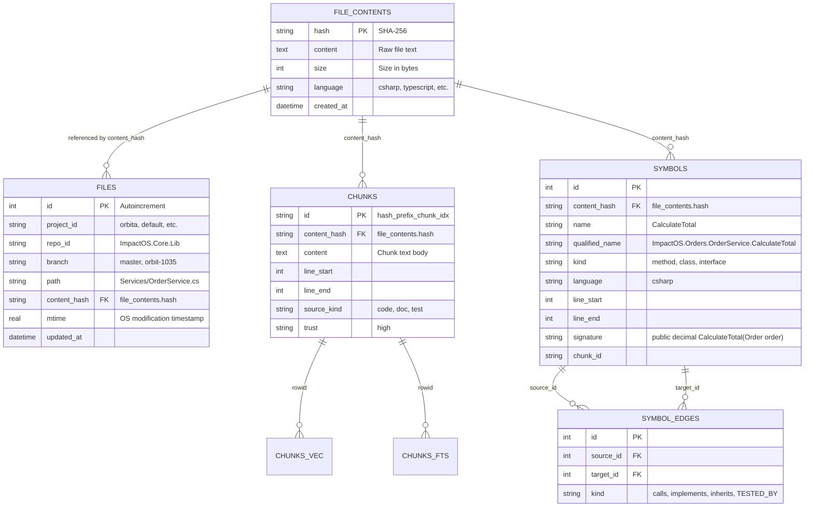
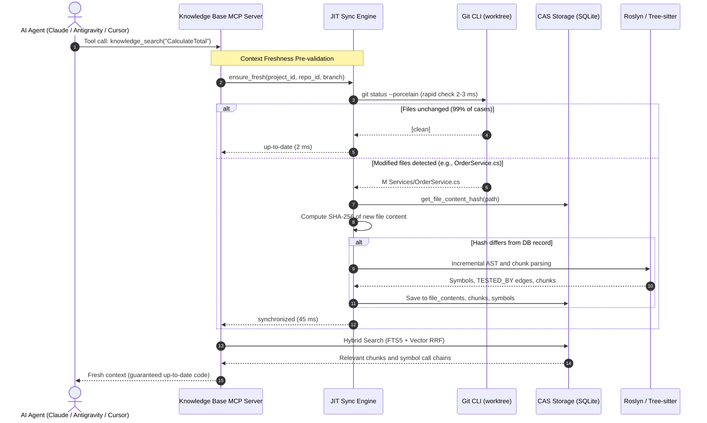

# ADR-008: Multi-Worktree Architecture, Content-Addressable Storage (CAS), and Hybrid Synchronization for AI Agents

| Metadata | Value |
| :--- | :--- |
| **Status** | Accepted |
| **Date** | 2026-10-23 |
| **Affects** | Core Engine, Data Layer (SQLite CAS), Sync Engine (JIT + Watcher + Hooks), Code Review Graph, Institutional Memory, Target Agent Adapters, Web UI Dashboard |
| **Related To** | [ADR-001: Local MCP RAG Knowledge Base](adr-001-local-mcp-rag-knowledge-base.md), [ADR-002: Hybrid Semantic and Graph Indexing](adr-002-hybrid-semantic-graph-indexing.md), [ADR-004: Autonomous Sync Triggers & Credentials](adr-004-autonomous-sync-triggers-credentials.md), [ADR-005: Web Dashboard Architecture](adr-005-web-dashboard-architecture.md), [ADR-006: FTS5 External Content & Batching](adr-006-fts5-external-content-and-large-repo-batching.md), [ADR-007: Interactive Document Inspector & Mermaid](adr-007-interactive-chat-doc-inspector-and-mermaid.md) |
| **Breaking Change** | No (100% Backward Compatible) |

---

## 1. Context and Problem Statement

### 1.1. Multi-Repository Workspaces and the Git Worktree Pattern
In large-scale enterprise environments (e.g., the workspace layout pattern `C:\Repos\DVCN\Orbita`), engineers and autonomous AI agents do not work within a single repository clone. Instead, they operate across interconnected repositories with multiple concurrent **Git Worktrees**:
- Base trunk branch: `worktrees/master`
- Concurrent feature task worktrees: `worktrees/orbit-1035`, `worktrees/orbit-1042`, `worktrees/hotfix-auth`, etc.

All worktrees share the underlying physical `.git` object repository, but each represents an independent working directory in the host filesystem.

### 1.2. Storage Explosion in Existing Tools (The `code-review-graph` Bottleneck)
Earlier attempts to provide multi-branch graph indexing (specifically, the `code-review-graph` / CRG prototype) relied on complete database isolation: each individual worktree created a dedicated `.code-review-graph/` directory containing a full SQLite database, AST symbol index, and dense vector embeddings.

This design caused severe production issues:
1. **Storage Bloat of 7–10 GB:** In active development, task branches diverge from `master` by only 1–3% of their files. Under isolated indexing, 97–99% of unchanged files, AST symbol graphs, FTS5 indices, and dense vector embeddings (E5 model) were duplicated for every single worktree. Across 5–8 worktrees, disk footprint exceeded 7 GB.
2. **CPU and Memory Exhaustion:** Creating or switching worktrees triggered a full re-indexing of gigabytes of unmodified code, locking CPU cores and exhausting host developer machine resources.
3. **Fragmented Embedding Cache:** Identical functions and code chunks were repeatedly vectorized dozens of times.

### 1.3. Strict Zero-Footprint Requirement in Client Repositories
Enterprise security guidelines and repository hygiene standards strictly prohibit contaminating client Git working trees with auxiliary metadata directories (`.knowledgebase/`, `.crg/`, local `.db` files, or agent config injections).
- All knowledge base databases, symbol graphs, and search indices must reside **centrally** inside the Knowledge Base MCP data volume (`/data`).
- Client code repositories must maintain an absolute **Zero-Footprint** guarantee with zero file modifications or uncommitted artifacts.

### 1.4. Agent Stale Context and Synchronization Lag
Modern autonomous coding agents (**Claude Code**, **Antigravity**, **Cursor**, **Codex**) continuously mutate source code across active worktrees. Traditional polling (Cron every 5 minutes) or remote Git webhooks are insufficient:
- An agent modifies a method signature using a file editing tool (`Edit` / `Write`).
- 1–2 seconds later, the agent calls `knowledge_get_callers` or `knowledge_search`.
- If the knowledge base has not updated, the agent receives stale context, triggering cascading hallucinations and flawed refactorings.
- Standard file watchers alone do not provide a 100% freshness guarantee due to OS-level event queue overflow or high I/O latency.

---

## 2. Decision

### 2.1. Content-Addressable Storage (CAS) Architecture
The storage engine completely decouples the **logical file path** in a project/worktree from its **physical file content**.



#### How CAS Operates:
1. The `file_contents` table acts as the single source of truth for all indexed code, keyed by its cryptographic SHA-256 hash (`hash TEXT PRIMARY KEY`).
2. The `files` table contains lightweight logical pointers with a composite unique index:
   - `UNIQUE(project_id, repo_id, branch, path)`.
3. The `chunks`, `symbols`, `chunks_vec` (dense vector embeddings), and `chunks_fts` (full-text search) tables reference `content_hash` directly.
4. **Deduplication Impact:** Because 98% of source files between `worktrees/master` and `worktrees/orbit-1035` share identical content, they reference identical rows in `file_contents`. The SQLite database for 10 concurrent worktrees requires only **~1.5 GB instead of 7–10 GB** (saving over 80% disk space with zero redundant vectorization).

### 2.2. 100% Backward Compatibility Guarantee
The v1.8 architecture preserves complete backward compatibility with existing single-repo setups and databases:
1. **Zero-Config Defaults:** Existing standalone repositories configured via `repositories:` automatically default to:
   - `project_id = 'default'`
   - `branch = 'master'`
2. **Transparent Migration:** Database migration `20261101_12_cas_and_multi_worktree` normalizes existing files and chunks into `files` and `file_contents` without data loss or downtime.
3. **Instant Feature Upgrade:** Standalone repositories immediately gain JIT microsecond validation, code review graph analysis, and token-saving rule indexing.

### 2.3. Hybrid Synchronization Engine (JIT + Watcher + Hooks)
To guarantee real-time context freshness without CPU saturation, a 3-tier hybrid pipeline is implemented:

```mermaid
flowchart TD
    subgraph TriggerLayer["1. Trigger & Agent Layer"]
        IDE["Developer in IDE (Cursor / VS Code)"]
        Agy["Antigravity / Codex"]
        Claude["Claude Code (Edit / Write Tools)"]
    end

    subgraph SyncEngine["2. Hybrid Synchronization Engine"]
        HookDetector["Claude PostToolUse Hook & SessionStart"]
        WinWatcher["Win32 Kernel File Watcher (ReadDirectoryChangesW)"]
        JIT["JIT Verification Engine (git status --porcelain, 2-3 ms)"]
    end

    subgraph StorageLayer["3. CAS SQLite Storage"]
        FastHash["Fast SHA-256 Check"]
        DeltaIndex["Incremental Re-indexing of 1-2 Files"]
        CASDB[("CAS Storage (file_contents, chunks, symbols)")]
    end

    subgraph MCPResponses["4. MCP Server Responses"]
        MCPTool["Tool Call (knowledge_search, knowledge_find_symbol, etc.)"]
        FreshContext["100% Fresh and Consistent Context"]
    end

    Claude -->|PostToolUse| HookDetector
    IDE & Agy -->|File Written| WinWatcher
    WinWatcher -.->|Invalidate Cache| JIT
    HookDetector -.->|Warmup Index| DeltaIndex

    MCPTool --> JIT
    JIT -->|Dirty files detected?| FastHash
    FastHash -->|Hash changed| DeltaIndex
    DeltaIndex --> CASDB
    FastHash -->|Hash unchanged| CASDB
    JIT -->|Clean (99% of cases, 2 ms)| CASDB
    CASDB --> FreshContext
```

#### The Three Synchronization Tiers:
1. **JIT Microsecond Validation (Just-In-Time Check):**
   - Executed before servicing any search, graph, or review MCP tool call.
   - Runs `git status --porcelain` on the target worktree. Execution time is **2–3 ms**.
   - In 99% of queries, the worktree is clean, and the request immediately executes against SQLite.
   - If dirty, added, or deleted files are detected, the JIT engine incrementally indexes only those specific files into CAS in **50–100 ms** immediately before returning the response.
   - **Guaranteed Result:** Zero hallucinations or stale context, even if a file was edited 500 ms ago.
2. **Win32 Kernel File Watcher:**
   - Background thread operating via the Windows kernel API `ReadDirectoryChangesW` (with IOCP / overlapped I/O).
   - Near-zero CPU overhead during idle; real-time filesystem event reception.
   - Proactively warms the index for Cursor and Codex/Copilot environments that lack tool completion hooks.
3. **Agent Lifecycle Hooks:**
   - Directly triggers delta indexing via `PostToolUse` hooks in Claude Code and Antigravity plugin lifecycle hooks (`on_tool_call`) when code editing tools (`Edit`, `Write`) terminate.

### 2.4. Code Review Graph (CRG) Best Practices Adaptation
Key analytical capabilities from CRG have been integrated natively into CAS:

#### 1. Tool `knowledge_review_context`:
- Parameters: `project_id`, `repo_id`, `source_branch` (task worktree), and `target_branch` (defaults to `master`).
- Compares `content_hash` sets between branches via SQL `EXCEPT` / `JOIN` in single-digit milliseconds.
- Computes **Blast Radius**: identifies all external symbols calling modified methods (traversing `symbol_edges` with kind `calls`).
- Calculates **Risk Score (0–100)**: multi-factor scoring based on cyclomatic complexity, call graph depth, and missing test coverage.
- Detects **Test Gaps**: generates actionable warnings for modified methods lacking `TESTED_BY` relationships.

#### 2. `TESTED_BY` Relationships and Test Association:
- **Roslyn Parser (C# / .NET 8 / .NET Framework):** Detects test classes and test methods via attributes `[Fact]`, `[Test]`, `[Theory]`, `[TestCase]`.
- **Tree-sitter Parser (TypeScript / Python):** Detects `describe`, `it`, `test` calls and `test_*` functions.
- Associates test methods with production code via naming heuristics (`OrderServiceTests` $\leftrightarrow$ `OrderService`) and AST invocation chains.
- Stores bidirectional edges in `symbol_edges` with kind `TESTED_BY`.

### 2.5. Centralized Institutional Memory and Rule Token Optimization
In enterprise repositories, guidance files (e.g., `CLAUDE.md`, architectural guidelines, specs in `.kb/`) often reach **50–80 KB**.
- Injecting an entire 76 KB `CLAUDE.md` into every prompt consumes 20,000–35,000 context tokens per interaction, exhausting the model's working window.
- **Knowledge Base MCP v1.8 Solution:**
  1. The `.kb/` directory and guidelines (`CLAUDE.md`, `.cursorrules`) are automatically indexed in CAS as structured chunks (`source_kind = 'rule' | 'doc'`).
  2. Implemented tool `knowledge_get_project_rules(topic)`: agents retrieve only the rules relevant to the current task (e.g., `"ef_migrations"`, `"api_response_format"`, `"naming_conventions"`).
  3. Reduces context payload from 76 KB down to 1.5 KB, saving up to **95% of prompt tokens** while enforcing rigorous project standards.

### 2.6. Dedicated `/dashboard` UI & Telemetry
A dedicated `/dashboard` overview view is introduced into the Web UI:
1. **Token Savings Telemetry Widget:** Real-time metrics based on `token_savings_log` tracking tokens saved via chunked rule retrieval and targeted RAG queries, along with estimated budget savings.
2. **CAS Storage Compression Widget:** Compares physical SQLite database size on disk against virtual uncompressed worktree storage (*"Database: 1.48 GB | Virtual Worktrees: 8.65 GB | Saved: 7.17 GB (82.9%)"*).
3. **Engine Health Monitor:** Live indicators for the Win32 File Watcher, JIT verification latency (ms), and background sync queues.
4. **Workspace Navigation:** Hierarchical tree view in `/repositories`, branch-scoped filtering in `/queue`, and branch context selection in `/chat`.

### 2.7. Target Agent Integration Matrix

| Agent | Connection Protocol | Synchronization Mechanism | Guideline & Rule Delivery | Zero-Footprint Guarantee |
| :--- | :--- | :--- | :--- | :--- |
| **Claude Code** | MCP (`stdio` / `sse`) | Native `.claude/settings.json` hooks (`PostToolUse` on `Edit\|Write`, `PreToolUse` on `knowledge_search`, `SessionStart`) + JIT | Concise `CLAUDE.md` instructing invocation of `knowledge_get_project_rules` | Complete: configuration in `.claude/settings.json` or global user profile |
| **Antigravity (AGY)** | MCP (native integration) | Native AGY plugin lifecycle hooks (`on_tool_call`) + JIT (2–3 ms) | Custom Rule / Customization AGY $\rightarrow$ `knowledge_get_project_rules` | Complete: configuration in `~/.gemini/antigravity` |
| **Cursor** | MCP (Cursor Features) | Win32 File Watcher (`ReadDirectoryChangesW`) + JIT validation | Concise `.cursorrules` instructing invocation of rule tool | Complete: configuration in Cursor User Settings / MCP config |
| **Codex / Copilot** | MCP / Tool Calling | Win32 File Watcher + JIT validation | System prompt $\rightarrow$ `knowledge_get_project_rules` | Complete: centralized tool configuration |

---

## 3. Component Interaction Flow



---

## 4. Consequences and Trade-offs

### Advantages:
1. **Dramatic Storage Savings:** SQLite footprint decreases from 7–10 GB down to ~1.5 GB through complete cross-worktree content deduplication.
2. **Zero-Footprint:** Clean Git state in client repositories without local metadata directories or cache files.
3. **Zero Sync Lag:** JIT validation (2–3 ms) guarantees real-time accuracy during continuous code editing.
4. **95% Token Reduction:** Targeted rule retrieval replaces bloated 76 KB instruction prompts.
5. **Deep Review Insights:** `knowledge_review_context` equips agents with automated blast radius calculations, risk scoring, and test gap analysis.
6. **Full Backward Compatibility:** Standalone single-repository setups operate without config adjustments.

### Trade-offs and Mitigations:
1. **Initial Import SHA-256 Overhead:**
   - *Risk:* Computing SHA-256 hashes across tens of thousands of files during initial indexing consumes additional CPU time.
   - *Mitigation:* Multi-threaded indexing worker with batch commits (`BATCH_COMMIT_SIZE = 50`) and in-memory mtime caching.
2. **Concurrent SQLite Access during Parallel JIT Checks:**
   - *Risk:* `database is locked` contention during concurrent write operations from multiple agents.
   - *Mitigation:* `PRAGMA journal_mode = WAL;`, `busy_timeout = 60000`, and serialized write transactions via background worker queues and `threading.RLock`.
3. **JIT Dependency on Git CLI:**
   - *Risk:* Executing `git status --porcelain` requires a functional Git binary in the environment.
   - *Mitigation:* Git is pre-installed in the official Docker image; on Windows hosts, availability of `git.exe` in `PATH` is verified with graceful fallback to the Win32 File Watcher if Git is unavailable.
