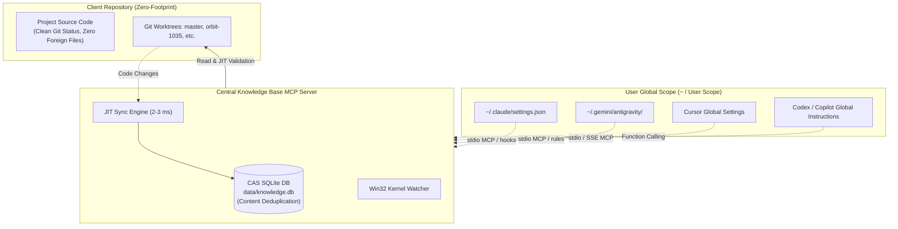

# AI Agent Integration Guide: Knowledge Base MCP
## Claude Code, Antigravity, Cursor, Codex / Copilot

This practical guide details how to integrate Knowledge Base MCP v1.8 with the four leading autonomous AI coding agents: **Claude Code**, **Antigravity (AGY)**, **Cursor**, and **Codex / Copilot**.

---

## 1. The Zero-Footprint Architectural Principle

### Why Enterprise Repositories Require Zero-Footprint
Enterprise projects (such as multi-repo workspaces with active Git Worktrees) enforce strict security and repository hygiene guidelines:
1. **No External Files in Git History:** Committing local tool configurations (`.claude/`, `.cursor/`, `.cursorrules`, ad-hoc scripts, or IDE settings) into client repositories is strictly prohibited.
2. **No Local Metadata Databases:** Creating metadata directories (`.crg/`, `.knowledgebase/`, local SQLite `.db` files) inside client worktrees pollutes `git status`, breaks CI/CD pipelines, and wastes gigabytes of disk storage.

### How Knowledge Base MCP Delivers True Zero-Footprint


- **Centralized Storage:** All AST symbol graphs, caller edges, full-text indexes, and vector embeddings reside centrally in `data/knowledge.db` (or inside the server Docker volume).
- **User-Level Configuration:** All MCP server connections, rules, and hooks are configured in the user's home directory (`~/.claude/`, `~/.gemini/antigravity/`, Cursor User Settings), never touching client repositories.
- **On-Demand Institutional Memory:** The `knowledge_get_project_rules(topic)` tool delivers targeted rules (1–2 KB) directly from the central database, eliminating the need to store and inject bloated 80 KB instruction files into prompt context.

---

## 2. Turnkey Setup on a Fresh Machine

### Option A: The One-Click Bootstrap Script (Recommended)
When cloning to a new machine (Windows, Linux, macOS), you do not need to manually configure environments or edit JSON files:

`ash
# Windows (PowerShell)
.\setup.ps1

# Linux / macOS (Bash)
chmod +x ./setup.sh && ./setup.sh
`
This automatically initializes the virtual environment, installs the package, binds the absolute Python paths, registers the global knowledge-mcp CLI, and configures agent profiles (~/.claude/settings.json, ~/.gemini/antigravity/mcp_config.json, ~/.cursor/mcp.json, etc.).

### Option B: The Global CLI (knowledge-mcp)
Once installed (or installed via pipx install git+https://...):
`ash
knowledge-mcp preset all --install
`

---

## 2. Turnkey One-Command Installer & Preset Generator (`preset`)

Knowledge Base MCP provides a built-in CLI tool that can automatically install, merge, or generate agent configurations in a single command:

```bash
# 1. Turnkey safe installation into USER GLOBAL profile (default, Zero-Footprint):
python -m knowledge_mcp.main preset claude --install       # Configures ~/.claude/settings.json + CLAUDE.md
python -m knowledge_mcp.main preset antigravity --install  # Configures ~/.gemini/antigravity/mcp_config.json + rules
python -m knowledge_mcp.main preset cursor --install       # Configures ~/.cursor/mcp.json + rules
python -m knowledge_mcp.main preset codex --install        # Configures ~/.codex/instructions.md
python -m knowledge_mcp.main preset all --install          # Configures all supported agents in one step

# 2. Local PROJECT-LEVEL installation (target current workspace only):
python -m knowledge_mcp.main preset claude --install --project  # Configures ./.claude/settings.json + ./CLAUDE.md
python -m knowledge_mcp.main preset cursor --install --project  # Configures ./.cursor/mcp.json + ./.cursorrules
python -m knowledge_mcp.main preset all --install --project     # Configures all presets inside current workspace

# 2. Print ready-to-use snippets for all agents to stdout:
python -m knowledge_mcp.main preset all

# 3. Export configuration templates to a custom target directory:
python -m knowledge_mcp.main preset all --output-dir ~/.knowledgebase-presets
```

---

## 3. Integrating with Claude Code

Claude Code supports native lifecycle hooks for tool execution and session startup.

### Step 1. Register MCP Server in User Scope
Run the Claude CLI command with `--scope user`:
```bash
claude mcp add knowledgebase --scope user -- python -m knowledge_mcp.main mcp
```
*(Or specify the absolute path to your Python virtual environment executable).*

### Step 2. Configure Hooks in `~/.claude/settings.json`
Add or merge the following hooks into `~/.claude/settings.json`:
```json
{
  "mcpServers": {
    "knowledgebase": {
      "command": "python",
      "args": [
        "-m",
        "knowledge_mcp.main",
        "mcp"
      ]
    }
  },
  "hooks": {
    "SessionStart": [
      {
        "command": "python -m knowledge_mcp.main sync-file --check-status"
      }
    ],
    "PostToolUse": [
      {
        "matcher": "Edit|Write",
        "command": "python -m knowledge_mcp.main sync-file --file \"$FILE\""
      }
    ],
    "PreToolUse": [
      {
        "matcher": "Grep|Glob",
        "command": "echo \"[KnowledgeBase MCP] Recommendation: invoke knowledge_search or knowledge_review_context for precise semantic and graph retrieval before global Grep/Glob.\""
      }
    ]
  }
}
```

#### Hook Roles:
- **`SessionStart`:** Executes `sync-file --check-status`, verifying database accessibility and active repository count at session initialization.
- **`PostToolUse` on `Edit|Write`:** Whenever Claude modifies code, this invokes the lightweight incremental JIT indexer (~30–50 ms), keeping AST and symbol graphs immediately fresh.
- **`PreToolUse` on `Grep|Glob`:** Nudges the model toward semantic tools (`knowledge_search`, `knowledge_review_context`), preventing brute-force directory scanning.

### Step 3. Project Guidelines Delivery
Add to Claude's global user guidelines:
```markdown
At session start or before implementing changes, invoke the MCP tool knowledge_get_project_rules(topic=...) to retrieve active coding standards, database migration patterns, and test isolation guidelines.
```

---

## 4. Integrating with Antigravity (AGY)

Antigravity uses native MCP configuration located under `~/.gemini/antigravity`.

### Step 1. MCP Configuration
In `~/.gemini/antigravity/mcp_config.json`:
```json
{
  "mcpServers": {
    "knowledgebase": {
      "command": "python",
      "args": [
        "-m",
        "knowledge_mcp.main",
        "mcp"
      ],
      "env": {
        "PYTHONUNBUFFERED": "1"
      }
    }
  }
}
```

### Step 2. Antigravity System Rule
Create a user rule file `~/.gemini/antigravity/rules/knowledgebase.md`:
```markdown
# KnowledgeBase MCP Priority Guidelines

When developing, navigating codebases, or performing refactorings, prioritize KnowledgeBase MCP tools:
- `knowledge_search` — semantic and hybrid full-text search across the codebase.
- `knowledge_find_symbol` — direct jump to declarations of classes, methods, and interfaces.
- `knowledge_get_callers` / `knowledge_get_callees` — call graph and dependency impact analysis.
- `knowledge_review_context` — compute blast radius, risk scoring, and test coverage gaps before submitting changes.

Before beginning task implementation, call `knowledge_get_project_rules(topic=...)` to retrieve relevant architectural invariants and coding standards.
```

---

## 5. Integrating with Cursor

In Cursor, configuration is managed via **Cursor Settings** or the global configuration file `~/.cursor/mcp.json`.

### Step 1. Register Server via Settings or JSON
In **Cursor Settings $\rightarrow$ Features $\rightarrow$ MCP $\rightarrow$ Add New MCP Server**:
- **Name:** `knowledgebase`
- **Type:** `command` (stdio)
- **Command:** `python -m knowledge_mcp.main mcp`

Or directly in `~/.cursor/mcp.json`:
```json
{
  "mcpServers": {
    "knowledgebase": {
      "command": "python",
      "args": [
        "-m",
        "knowledge_mcp.main",
        "mcp"
      ]
    }
  }
}
```
*(Alternatively, connect via SSE: `http://localhost:8000/sse` when running the Knowledge Base MCP server in `serve` mode).*

### Step 2. Cursor AI Rules
In Cursor User Settings (**Cursor Settings $\rightarrow$ General $\rightarrow$ Rules for AI**) or inside `.cursorrules`:
```markdown
Always use KnowledgeBase MCP tools (knowledge_search, knowledge_find_symbol, knowledge_review_context) for code exploration and blast-radius analysis. Before implementing changes, invoke knowledge_get_project_rules(topic=...) to retrieve active coding standards and test isolation guidelines.
```

### Automatic Freshness in Cursor
Cursor lacks a native `PostToolUse` lifecycle hook. Freshness is guaranteed via two complementary layers:
1. **Low-Level Win32 File Watcher:** Kernel filesystem listener (`ReadDirectoryChangesW`) intercepts file modifications and proactively updates dirty caches.
2. **JIT Validation:** Every `knowledge_search` or `knowledge_find_symbol` call executes a microsecond `git status` check (2–3 ms). Modified files are incrementally indexed before returning the response.

---

## 6. Integrating with Codex / Copilot CLI / OpenAI Assistants

For Codex and GitHub Copilot agents, integration operates via custom system prompts and registered function-calling tools.

### System Prompt Snippet
Add to agent custom instructions:
```markdown
You have access to the KnowledgeBase MCP tools. Prioritize using `knowledge_search` and `knowledge_find_symbol` for exploring code architecture, callers, and callees instead of scanning entire directories. Before executing code changes or creating pull requests, call `knowledge_get_project_rules` with the relevant topic to load coding standards, and use `knowledge_review_context` to assess blast radius and test coverage.
```

---

## 7. Verification and Diagnostics

To verify database status and workspace resolution:
```bash
python -m knowledge_mcp.main sync-file --check-status
```

Expected output:
```text
[KnowledgeBase MCP] Status: OK
Database: data/knowledge.db (accessible)
Workspaces: 1 project(s), 4 repository(ies)
Indexed files in CAS: 1956
```

To test incremental synchronization on a single file:
```bash
python -m knowledge_mcp.main sync-file --file path/to/OrderService.cs
```

Expected output:
```text
[JIT] Indexed OrderService.cs in repo 'ImpactOS.Core' (branch: 'orbit-1035', project: 'orbita')
```

---

## 8. Agent Capability Matrix

| Capability | Claude Code | Antigravity | Cursor | Codex / Copilot |
| :--- | :---: | :---: | :---: | :---: |
| **Protocol** | `stdio` | `stdio` | `stdio` / `sse` | `stdio` / Tool Calling |
| **Zero-Footprint** | Yes (`--scope user`) | Yes (`~/.gemini`) | Yes (User Settings) | Yes (Global Instructions) |
| **JIT Verification** | 2–3 ms | 2–3 ms | 2–3 ms | 2–3 ms |
| **Win32 File Watcher** | Yes | Yes | Yes (Primary) | Yes (Primary) |
| **PostToolUse Hook** | Yes (`Edit\|Write`) | Yes (`on_tool_call`) | Via Watcher + JIT | Via Watcher + JIT |
| **Project Rules Hub** | `knowledge_get_project_rules` | `knowledge_get_project_rules` | `knowledge_get_project_rules` | `knowledge_get_project_rules` |
| **Blast Radius Review** | `knowledge_review_context` | `knowledge_review_context` | `knowledge_review_context` | `knowledge_review_context` |
