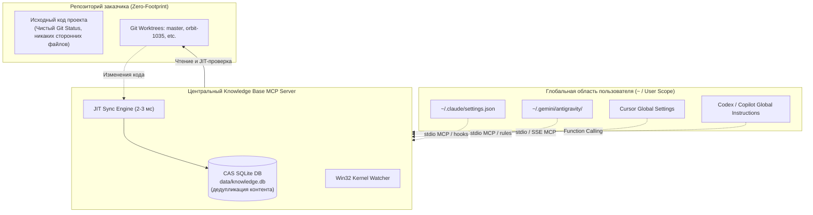

# Руководство по интеграции AI-агентов с Knowledge Base MCP
## Claude Code, Antigravity, Cursor, Codex / Copilot

Это практическое руководство описывает процесс интеграции Knowledge Base MCP v1.8 с четырьмя ведущими AI-агентами: **Claude Code**, **Antigravity (AGY)**, **Cursor** и **Codex / Copilot**.

---

## 1. Архитектурный принцип Zero-Footprint

### Почему корпоративные репозитории требуют Zero-Footprint
При работе в корпоративных проектах (например, enterprise-воркспейсы с десятками репозиториев и рабочими деревьями Git Worktrees) действуют строгие политики безопасности и гигиены кода:
1. **Запрет сторонних файлов в Git-истории:** Категорически запрещено коммитить конфигурации локальных инструментов (`.claude/`, `.cursor/`, `.cursorrules`, служебные скрипты или настройки IDE).
2. **Запрет локальных баз данных:** Создание служебных папок (`.crg/`, `.knowledgebase/`, локальных баз SQLite) внутри рабочих деревьев загрязняет `git status`, ломает CI/CD пайплайны и приводит к дублированию гигабайтов данных на диске.

### Как Knowledge Base MCP обеспечивает абсолютный Zero-Footprint


- **Централизованное хранилище:** Вся база знаний, индексы AST, связи вызовов и векторные эмбеддинги хранятся централизованно в `data/knowledge.db` (или в Docker-контейнере сервера).
- **Глобальные пользовательские конфигурации:** Все подключения MCP-сервера, правила и хуки настраиваются в домашней директории пользователя (`~/.claude/`, `~/.gemini/antigravity/`, Cursor User Settings), не затрагивая репозитории заказчика.
- **Институциональная память по запросу:** Инструмент `knowledge_get_project_rules(topic)` отдает точечные правила (1–2 КБ) прямо из центральной базы знаний, избавляя от необходимости хранить и передавать в промпте 80-килобайтные файлы инструкций.

---

## 2. CLI-генератор готовых пресетов (`preset`)

Knowledge Base MCP включает CLI-команду для моментальной генерации шаблонов и конфигов:

```bash
# Вывести готовые сниппеты для всех агентов в консоль:
python -m knowledge_mcp.main preset all

# Экспортировать конфигурационные файлы во временный или целевой каталог:
python -m knowledge_mcp.main preset all --output-dir ~/.knowledgebase-presets

# Экспортировать настройки конкретного агента:
python -m knowledge_mcp.main preset claude --output-dir ~/.claude
python -m knowledge_mcp.main preset antigravity --output-dir ~/.gemini/antigravity
python -m knowledge_mcp.main preset cursor --output-dir ~/.cursor
```

---

## 3. Интеграция с Claude Code

Claude Code поддерживает нативные хуки жизненного цикла инструментов и сессий.

### Шаг 1. Добавление MCP-сервера в глобальном скоупе
Выполните команду Claude CLI с флагом `--scope user`:
```bash
claude mcp add knowledgebase --scope user -- python -m knowledge_mcp.main mcp
```
*(Либо укажите абсолютный путь к Python виртуального окружения Knowledge Base MCP).*

### Шаг 2. Настройка хуков в `~/.claude/settings.json`
Создайте или объедините с существующим файлом `~/.claude/settings.json` конфигурацию хуков:
```json
{
  "mcpServers": {
    "knowledgebase": {
      "command": "python",
      "args": [
        "-m",
        "knowledge_mcp.main",
        "mcp"
      ]
    }
  },
  "hooks": {
    "SessionStart": [
      {
        "command": "python -m knowledge_mcp.main sync-file --check-status"
      }
    ],
    "PostToolUse": [
      {
        "matcher": "Edit|Write",
        "command": "python -m knowledge_mcp.main sync-file --file \"$FILE\""
      }
    ],
    "PreToolUse": [
      {
        "matcher": "Grep|Glob",
        "command": "echo \"[KnowledgeBase MCP] Рекомендуется использовать knowledge_search или knowledge_review_context для точного семантического и графового анализа перед глобальным Grep/Glob.\""
      }
    ]
  }
}
```

#### Назначение хуков:
- **`SessionStart`:** Вызывает `sync-file --check-status`, проверяя доступность базы знаний и количество активных репозиториев/ворктри при старте сессии Claude.
- **`PostToolUse` на `Edit|Write`:** При сохранении или редактировании любого файла Claude вызывает легковесный инкрементальный JIT-индексатор (~30–50 мс), мгновенно актуализируя AST и символы.
- **`PreToolUse` на `Grep|Glob`:** Напоминает агенту использовать инструменты `knowledge_search` и `knowledge_review_context`, предотвращая слепой перебор файлов.

### Шаг 3. Доставка правил проекта
Добавьте в глобальные инструкции Claude (или в секцию инструкций пользователя):
```markdown
В начале сессии или перед реализацией задачи вызови MCP-инструмент knowledge_get_project_rules(topic=...) для получения актуальных стандартов кода, правил работы с тестовой БД и изоляции тестов.
```

---

## 4. Интеграция с Antigravity (AGY)

Antigravity использует нативную интеграцию MCP через конфигурационный каталог `~/.gemini/antigravity`.

### Шаг 1. Конфигурация MCP-сервера
В файле `~/.gemini/antigravity/mcp_config.json`:
```json
{
  "mcpServers": {
    "knowledgebase": {
      "command": "python",
      "args": [
        "-m",
        "knowledge_mcp.main",
        "mcp"
      ],
      "env": {
        "PYTHONUNBUFFERED": "1"
      }
    }
  }
}
```

### Шаг 2. Системное правило Antigravity
Создайте файл правила `~/.gemini/antigravity/rules/knowledgebase.md`:
```markdown
# Приоритет KnowledgeBase MCP в Antigravity

При решении задач разработки, навигации по кодовой базе и рефакторинга всегда отдавай приоритет инструментам KnowledgeBase MCP:
- `knowledge_search` — семантический и гибридный поиск по базе знаний и кодовой базе.
- `knowledge_find_symbol` — быстрый переход к декларациям классов, методов, интерфейсов.
- `knowledge_get_callers` / `knowledge_get_callees` — анализ графа вызовов и зависимостей.
- `knowledge_review_context` — оценка радиуса поражения (blast radius), рисков и пробелов в тестах перед внесением изменений.

Перед началом реализации любой задачи вызови `knowledge_get_project_rules(topic=...)` для загрузки релевантных проектных правил, архитектурных инвариантов и стандартов тестирования.
```

---

## 5. Интеграция с Cursor

В Cursor подключение осуществляется через панель **Cursor Settings** или глобальный конфигурационный файл `~/.cursor/mcp.json`.

### Шаг 1. Подключение MCP через GUI или JSON
В **Cursor Settings $\rightarrow$ Features $\rightarrow$ MCP $\rightarrow$ Add New MCP Server**:
- **Name:** `knowledgebase`
- **Type:** `command` (stdio)
- **Command:** `python -m knowledge_mcp.main mcp`

Либо в `~/.cursor/mcp.json`:
```json
{
  "mcpServers": {
    "knowledgebase": {
      "command": "python",
      "args": [
        "-m",
        "knowledge_mcp.main",
        "mcp"
      ]
    }
  }
}
```

*(Опционально поддерживается подключение по протоколу SSE: URL `http://localhost:8000/sse`, если Knowledge Base MCP запущен в режиме `serve`).*

### Шаг 2. Настройка правил Cursor Rules
В пользовательских настройках Cursor (**Cursor Settings $\rightarrow$ General $\rightarrow$ Rules for AI**) или в локальном шаблоне `.cursorrules`:
```markdown
Always use KnowledgeBase MCP tools (knowledge_search, knowledge_find_symbol, knowledge_review_context) for code exploration and blast-radius analysis. Before implementing changes, invoke knowledge_get_project_rules(topic=...) to retrieve active coding standards and test isolation guidelines.
```

### Автоматическая синхронизация в Cursor
Поскольку в Cursor нет прямого хука `PostToolUse`, синхронизация обеспечивается двумя взаимодополняющими слоями ядра Knowledge Base MCP:
1. **Низкоуровневый Win32 File Watcher:** Фоновый поток ядра ОС (`ReadDirectoryChangesW`) перехватывает сохранение файлов редактором и упреждающе сбрасывает кэш.
2. **JIT-проверка перед ответом инструмента:** При любом вызове `knowledge_search` или `knowledge_find_symbol` движок выполняет микросекундный `git status` (2–3 мс). Если обнаружены измененные файлы, они мгновенно доиндексируются перед формированием ответа. Агент физически не может получить устаревший контекст!

---

## 6. Интеграция с Codex / Copilot CLI / OpenAI Assistants

Для агентов семейства Codex и GitHub Copilot интеграция выполняется через системный промпт и регистрацию MCP/Function Calling инструментов.

### Системный промпт (`system_prompt.snippet`)
Добавьте в системную инструкцию агента (Custom Instructions):
```markdown
You have access to the KnowledgeBase MCP tools. Prioritize using `knowledge_search` and `knowledge_find_symbol` for exploring code architecture, callers, and callees instead of scanning entire directories. Before executing code changes or creating pull requests, call `knowledge_get_project_rules` with the relevant topic to load coding standards, and use `knowledge_review_context` to assess blast radius and test coverage.
```

---

## 7. Быстрая проверка работоспособности (Healthcheck)

Для проверки статуса базы знаний и активных ворктри выполните:
```bash
python -m knowledge_mcp.main sync-file --check-status
```

Пример вывода:
```text
[KnowledgeBase MCP] Status: OK
Database: data/knowledge.db (accessible)
Workspaces: 1 project(s), 4 repository(ies)
Indexed files in CAS: 1956
```

Для проверки инкрементальной синхронизации одного файла:
```bash
python -m knowledge_mcp.main sync-file --file path/to/OrderService.cs
```

Пример вывода:
```text
[JIT] Indexed OrderService.cs in repo 'ImpactOS.Core' (branch: 'orbit-1035', project: 'orbita')
```

---

## 8. Сводная матрица возможностей агентов

| Возможность | Claude Code | Antigravity | Cursor | Codex / Copilot |
| :--- | :---: | :---: | :---: | :---: |
| **Протокол** | `stdio` | `stdio` | `stdio` / `sse` | `stdio` / Function Calling |
| **Zero-Footprint** | Да (`--scope user`) | Да (`~/.gemini`) | Да (User Settings) | Да (Global Instructions) |
| **JIT-синхронизация** | 2–3 мс | 2–3 мс | 2–3 мс | 2–3 мс |
| **Win32 File Watcher** | Да | Да | Да (Основной) | Да (Основной) |
| **Хук PostToolUse** | Да (`Edit\|Write`) | Да (`on_tool_call`) | Через Watcher + JIT | Через Watcher + JIT |
| **Правила проекта** | `knowledge_get_project_rules` | `knowledge_get_project_rules` | `knowledge_get_project_rules` | `knowledge_get_project_rules` |
| **Анализ Blast Radius** | `knowledge_review_context` | `knowledge_review_context` | `knowledge_review_context` | `knowledge_review_context` |
