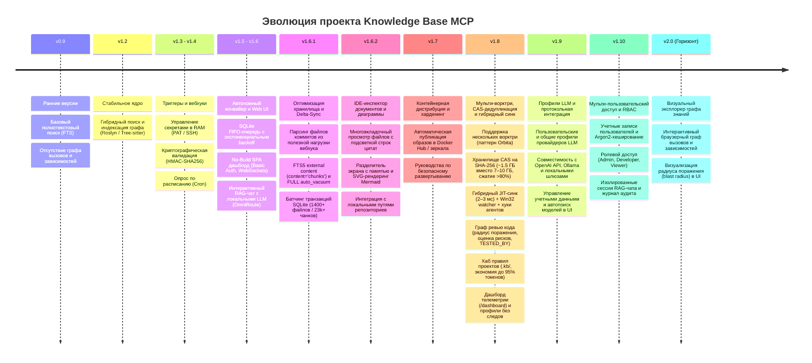

# Дорожная карта: Автономная работа и управление базой знаний

В данном документе описана стратегия развития MCP-сервера базы знаний (`knowledge-mcp`) в сторону полной автономности: автоматической реакции на изменения в подключенных репозиториях, глубокого структурного понимания кода и оптимизации работы с AI-ассистентами.

Текущая версия: **v1.8.0**

---

## Визуализация дорожной карты

---

## v1.3: Базовая конфигурация (Env / Файл настроек) — ✅ *Завершено*
- Конфигурация подписок и триггеров через переменные окружения (`.env`) или конфигурационный файл (`config.yaml`).
- Полностью автономная работа сервера сразу при старте контейнера без обязательного наличия визуального интерфейса.

## v1.3.1: Источники обновлений (Sources) — ✅ *Завершено*
- Определение параметров для Git-репозиториев (целевые ветки, таймауты).
- Безопасное хранение учетных данных в оперативной памяти (PAT через заголовок `http.extraHeader`, SSH-ключи без сохранения на диск).

## v1.4: Настройка триггеров (Triggers & Webhooks) — ✅ *Завершено*
- Входящий HTTP-эндпоинт `/webhook/git` с поддержкой GitHub, Gitea (`X-Hub-Signature-256`, `X-Gitea-Signature`) и GitLab (`X-Gitlab-Token`).
- Периодическая фоновая синхронизация по настраиваемому расписанию (Cron-выражения).

## v1.5: Автономный жизненный цикл обработки — ✅ *Завершено*
- Отказоустойчивая FIFO-очередь в SQLite (`sync_queue`) с фиксацией статуса выполнения.
- Фоновый воркер с экспоненциальной задержкой повторов (1 мин, 5 мин, 15 мин), защитой от фатальных сбоев и идемпотентностью по SHA коммита.

## v1.6: Панель управления и интерактивный RAG-чат — ✅ *Завершено*
- Легковесный No-Build SPA веб-интерфейс на базе FastAPI (чистый HTML5, Vanilla CSS и JS).
- Безопасность на базе Basic Auth с генерацией короткоживущих сессионных токенов для WebSockets и SSE.
- Телеметрия индексации в реальном времени с прогресс-барами и визуализатором очереди задач.
- Интерактивный RAG-чат с SSE-стримингом ответов, подсветкой синтаксиса и кликабельными ссылками на исходный код.

---

## v1.6.1: Оптимизация хранилища, батчинг и быстрая Delta-синхронизация — ✅ *Завершено*
- **Парсинг файлов из коммитов (Payload):** Прямое извлечение путей измененных, добавленных и удаленных файлов из вебхука (`commits[].added`, `commits[].modified`, `commits[].removed`) для мгновенной дельта-индексации без сканирования всего репозитория.
- **Портативность Docker Compose:** Относительные пути монтирования томов (`./data:/data`) и прозрачная загрузка конфигурации из `.env`.
- **Оптимизация хранения SQLite (ADR-006):** Таблица FTS5 с внешним контентом (`content='chunks'`), исключающая дублирование исходного текста; включение `PRAGMA auto_vacuum = FULL;` для автоматического сжатия базы данных.
- **Батчинг транзакций и устойчивость к нагрузкам:** Периодическая фиксация транзакций пакетами (`BATCH_COMMIT_SIZE = 50`) и тюнинг параметров движка SQLite (`temp_store = MEMORY`, `cache_size = -64000`, `busy_timeout = 60000`), позволившие бесперебойно проиндексировать 1 400+ файлов и 23 000+ фрагментов кода без ошибок дискового I/O.
- **Поддержка локальных репозиториев (`local_path`):** Прямая индексация локально примонтированных каталогов без необходимости клонирования, SSH-ключей или токенов.
- **Мутационное тестирование:** Настройка `mutmut` для проверки устойчивости базы данных и слоя персистентности.
- **Обновление документации:** Актуализация архитектурных решений (ADR), стандартов кодирования и `README.md`.

## v1.6.2: Интерактивный RAG-чат, IDE-инспектор документов и диаграммы — ✅ *Завершено*
- **Многовкладочный инспектор документов в стиле IDE (ADR-007):** Выделенная правая панель с вкладками для одновременного параллельного изучения нескольких файлов из цитат.
- **Подсветка строк и автоскролл к цитате:** Точная подсветка диапазонов строк (например, строки 6–9) оранжево-желтым цветом (`.line-highlight`) с плавным скроллом к фрагменту; быстрое переключение между просмотром изолированного фрагмента и полным файлом.
- **Переключение Markdown / Исходный код:** Удобный переключатель между форматированным представлением Markdown (с чекбоксами и таблицами) и сырым кодом с номерами строк и синтаксической подсветкой.
- **Рендеринг диаграмм Mermaid:** Отображение блоков Mermaid в виде интерактивных SVG с автоматической синхронизацией темной/светлой темы, шапками блоков кода с бейджем языка и копированием в один клик.
- **Разделитель с памятью и история диалога:** Перетаскиваемый разделитель (по умолчанию 45%) с быстрым сбросом по двойному клику; сохранение истории сообщений в памяти браузера с кнопкой «Новый диалог».
- **Разрешение путей репозиториев:** Бэкенд `/api/chat/file` с автоматическим сопоставлением путей по всем подключенным корням репозиториев (`local_path`, `clones_dir`, `project_dir`) с поддержкой `full_file=true`.

## v1.7: Контейнерная дистрибуция и надежность развертывания — ✅ *Завершено*
- **Автоматическая сборка и публикация образов (Docker Hub / реестры):**
  - Полноценный пайплайн GitHub Actions CI/CD (`.github/workflows/docker-publish.yml`) для сборки многоплатформенных образов (`:latest`, семантические теги версий).
  - Подробные руководства по работе через корпоративные прокси и настройке зеркал Docker daemon (`registry-mirrors`) для изолированных сетей.
  - См. руководство: [Публикация и дистрибуция контейнеров](deployment-and-docker-registry.md).
- *Примечание:* Расширенные метрики мониторинга ресурсов (память, диск, токен-метрики) и управление очередью синхронизации перенесены в полноценную архитектуру `/dashboard` в рамках **v1.8**.

---

## v1.8: Мульти-ворктри, CAS-дедупликация и гибридный движок синхронизации — ✅ *Завершено*
*Релиз: v1.8.0 | Архитектурная спецификация: [ADR-008: Multi-Worktree, CAS Deduplication and Hybrid Sync](adr-008-multi-worktree-cas-and-hybrid-sync.md)*

- **Рабочие пространства с несколькими Worktree и автообнаружение:**
  - Нативная оркестрация рабочих пространств для корпоративных репозиториев с Git Worktrees (паттерн компании `C:\Repos\DVCN\Orbita`: `worktrees/master`, `worktrees/{task}`).
  - Автоматическое обнаружение активных ворктри и рабочих задач через файловую систему и `git rev-parse --abbrev-ref HEAD`.
  - Гибкая группировка репозиториев через секцию `projects:` в `config.yaml`.
- **Движок дедупликации CAS (Content-Addressable Storage):**
  - Полное разделение логических путей (`files`) и физического содержимого файлов (`file_contents` с первичным ключом по SHA-256).
  - Символы AST (`symbols`), текстовые фрагменты (`chunks`), векторные эмбеддинги (`chunks_vec`) и поисковый индекс (`chunks_fts`) привязаны напрямую к хешам содержимого.
  - Радикальное сокращение дискового пространства с 7–10 ГБ до **~1.5 ГБ** для 10+ параллельных ворктри (сжатие более 80%) с полным исключением повторной векторизации неизмененных файлов.
- **100% обратная совместимость:**
  - Прозрачная работа со стандартными одиночными репозиториями (`project_id='default'`, `branch='master'`) без изменения существующего кода.
  - Безопасная автоматическая миграция базы данных (`20261101_12_cas_and_multi_worktree`) с сохранением всех исторических индексов без простоя.
  - Мгновенные JIT-проверки и инструменты ревью кода работают одинаково эффективно для всех типов подключений.
- **Гибридный движок синхронизации (JIT + Watcher + Хуки):**
  - **Микросекундная валидация JIT:** Мгновенная проверка `git status --porcelain` (2–3 мс) перед выполнением любого MCP-запроса, гарантирующая 100% актуальность контекста и исключающая галлюцинации LLM при правках в сторонних IDE.
  - **Kernel File Watcher (Win32):** Подписка на системные события ядра Windows (`ReadDirectoryChangesW`) с нулевым оверхедом для упреждающей инвалидации кэша в средах Cursor, Codex и Copilot.
  - **Хуки для AI-агентов:** Прямая интеграция жизненного цикла с Claude Code (`PostToolUse` для событий `Edit`/`Write`, `PreToolUse` для подсказок актуализации, `SessionStart`) и плагинами Antigravity.
- **Граф ревью кода и анализ радиуса поражения (Blast Radius):**
  - Инструмент `knowledge_review_context`: Мгновенный diff-анализ между рабочей веткой и `master` с расчетом радиуса поражения изменений и каскадных вызовов вверх по иерархии (upstream callers).
  - Оценка рисков (Risk Score от 0 до 100) на основе цикломатической сложности, глубины графа вызовов и пробелов в покрытии тестами.
  - Глубокие ассоциации с тестами: Автоматический парсинг тестовых наборов для C# (.NET / Roslyn) и TypeScript/Python (Tree-sitter), генерация связей `TESTED_BY` и выявление нетестированных измененных методов (Test Gaps).
  - Фильтрация автогенерируемого кода: Исключение файлов `*.Designer.cs`, `*ModelSnapshot.cs` и `*.g.cs` из тяжелого анализа, что предотвращает зависания и экономит дисковое пространство.
- **Централизованный хаб правил и оптимизатор токенов:**
  - Автоматическая индексация внутренней документации репозитория (каталог `.kb/`) и корпоративных регламентов (`CLAUDE.md`, `.cursorrules`).
  - Инструмент `knowledge_get_project_rules(topic)`: Точечная выдача только необходимых правил по теме вместо внедрения массивных файлов инструкций по 70–80 КБ, экономящая до 95% токенов контекста.
  - Поиск по архитектурным документам и регламентам `.kb/` через встроенный семантический и лексический поиск `knowledge_search`.
- **Дашборд веб-интерфейса (`/dashboard`) и расширенная телеметрия:**
  - **Виджет экономии токенов:** Учет сэкономленных токенов благодаря точности RAG и фрагментации правил (`token_savings_log`), процент сжатия контекста и финансовая экономия на API моделей.
  - **Виджет сжатия CAS:** Отображение реального размера базы SQLite в сравнении с виртуальным объемом несжатых ворктри (*«Хранилище: 1.48 ГБ | Виртуально: 8.65 ГБ | Сэкономлено: 7.17 ГБ / 83%»*).
  - **Мониторинг здоровья движка:** Индикаторы статуса Win32 File Watcher, задержки JIT-проверок (мс) и состояния очереди фоновой синхронизации.
  - **Навигация по веткам и проектам:** Иерархический просмотр воркспейсов в `/repositories`, фильтрация по веткам в очереди и чате.
- **Пресеты конфигурации для AI-агентов (Zero-Footprint):**
  - Готовые профили и хуки для **Claude Code**, **Antigravity (AGY)**, **Cursor** и **Codex/Copilot**.
  - Гарантия нулевого следа: полное отсутствие временных файлов, кэша или служебных баз данных внутри клиентских репозиториев с кодом.

---

## v1.9: Мульти-провайдерные профили LLM и протокольная интеграция — 📋 *Запланировано*
*Целевой релиз: v1.9.0 | Фокус: Архитектура, конфигурация и гибкость инфраструктуры*

- **Пользовательские и общие профили провайдеров:**
  - Настраиваемые пресеты профилей LLM в базе данных и конфигурации с метаданными владельца (`owner`, `is_shared`).
  - Поддержка корпоративных общедоступных профилей (управляются администратором) и персональных профилей пользователей.
  - Сохранение активного профиля для текущей пользовательской сессии.
  - Универсальная протокольная совместимость: OpenAI-совместимый Chat Completions (`/v1/chat/completions`), Ollama API и локальные шлюзы инференса (vLLM, LM Studio, LocalAI, OmniRoute, LiteLLM).
  - Поддержка широкого спектра провайдеров: коммерческие API (Anthropic, OpenAI, Google, DeepSeek, Mistral) и локальные open-source модели (Llama, Qwen, DeepSeek Coder).
  - Поддержка работы без ключей API для локальных серверов инференса.
- **Безопасное управление учетными данными в настройках:**
  - Интерфейс управления провайдерами в разделе настроек: создание, тестирование соединения, редактирование и сохранение.
  - Маскирование ключей API и токенов (`••••••••`) при вводе и хранении.
  - Визуальный индикатор источника учетных данных: переменные окружения (`ENV`) против сохраненной базы настроек.
- **Диагностика соединений и автопоиск моделей:**
  - Проверка доступности эндпоинта (healthcheck) с замером сетевой задержки и времени до первого токена (TTFT).
  - Автоматическое обнаружение доступных моделей через запрос к стандартным эндпоинтам `/v1/models` с заполнением выпадающего списка в UI.

---

## v1.10: Многопользовательский доступ, RBAC и командные пространства — 📋 *Запланировано*
*Целевой релиз: v1.10.0 | Фокус: Корпоративная безопасность и командная работа*

- **Управление пользователями и современная аутентификация:**
  - Выделенная таблица пользователей `users` с надежным хешированием паролей (Argon2 / bcrypt).
  - Переход от единого пароля Basic Auth к сессионной токенной авторизации (JWT / защищенные HTTP-only cookies).
  - Личный кабинет пользователя: смена пароля, выбор темы оформления и языка интерфейса.
- **Ролевое управление доступом (RBAC):**
  - Иерархия ролей: `Admin` (полный доступ к настройкам, подключению репозиториев и триггерам), `Developer` (поиск, запуск ручной синхронизации, настройка своих профилей LLM), `Viewer` (только чтение, поиск и просмотр документации).
  - Разграничение доступа на уровне репозиториев: ограничение видимости конфиденциальных проектов для определенных команд.
- **Изоляция пользовательских данных и аудит:**
  - Персональные сессии RAG-чата и изолированная история сообщений в SQLite с возможностью экспорта.
  - Журнал аудита действий (Audit Log): фиксация ручных запусков синхронизации, изменений настроек и доступа к проектам.

---

## v2.0 (Горизонт): Визуальный эксплорер графа знаний и архитектуры — 🔭 *Горизонт планирования*
*Оценка: Крупный мажорный релиз*
- **Интерактивный граф в веб-интерфейсе:** Встроенный браузерный визуализатор графа (на базе Cytoscape.js или vis.js) в Web Dashboard.
- **Навигация по зависимостям и вызовам:** Интерактивное перемещение по цепочкам вызовов, иерархиям наследования и связанным классам.
- **Визуальный анализ влияния (Blast Radius):** Наглядное цветовое подсвечивание модулей и методов, затронутых планируемыми изменениями кода.
- **Экспорт архитектурных схем:** Выгрузка актуальных архитектурных диаграмм в форматах SVG и Markdown.
