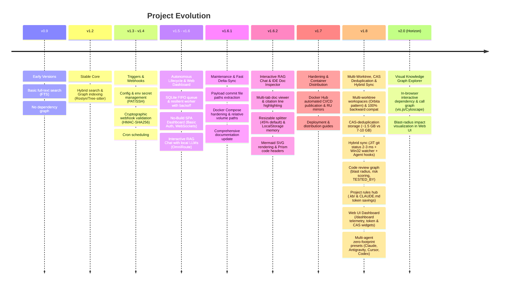

# Roadmap: Autonomous Operation & Knowledge Management

This document outlines the planned evolution of the knowledge base MCP server toward fully autonomous operation — automatically reacting to changes in connected repositories and providing deep code comprehension tools.

Current version: **v1.7.0 (v1.8 in progress)**

---

## Roadmap Visualization

---

## v1.3: Base Configuration (Env / Config File) — ✅ *Completed*
- Configure subscriptions and triggers via environment variables (`.env`) or a config file (`config.yaml`).
- Enables autonomous operation at container startup without requiring any visual interface.

## v1.3.1: Update Sources — ✅ *Completed*
- Define source parameters for Git repositories in configuration.
- Secure credential management in RAM (PAT via `http.extraHeader`, SSH without saving tokens on disk).

## v1.4: Trigger Configuration — ✅ *Completed*
- HTTP endpoint `/webhook/git` supporting GitHub, Gitea (`X-Hub-Signature-256`, `X-Gitea-Signature`) and GitLab (`X-Gitlab-Token`).
- Periodic scheduled updates (Cron expressions).

## v1.5: Autonomous Processing Lifecycle — ✅ *Completed*
- SQLite-backed FIFO queue (`sync_queue`) with persistent status tracking.
- Worker process with exponential backoff retries (1m, 5m, 15m), fatal halt protection, and Git SHA idempotency.

## v1.6: Management Dashboard & RAG Chat — ✅ *Completed*
- Lightweight No-Build SPA web interface on FastAPI (HTML5, Vanilla CSS/JS).
- Basic Auth security with short-lived session tokens for WebSockets and SSE.
- Real-time indexing telemetry with progress bars and queue viewer.
- Interactive RAG Chat with SSE streaming, code syntax highlighting, and clickable file sources.

---

## v1.6.1: Maintenance, Storage Optimization & Large-Scale Indexing — ✅ *Completed*
- **Payload file parsing:** Extract modified and added file paths directly from webhook commit payloads (`commits[].added`, `commits[].modified`, `commits[].removed`) and pass them to the indexer for instant delta-indexing without scanning entire repositories.
- **Docker Compose portability:** Relative volume mounts (`./data:/data`) and `.env` configuration file ingestion.
- **Storage optimization (ADR-006):** FTS5 external content table (`content='chunks'`) eliminating 100% text duplication; `PRAGMA auto_vacuum = FULL;` for automatic file compaction.
- **Transaction batching & resilience:** Periodic batch commits (`BATCH_COMMIT_SIZE = 50`) and SQLite engine tuning (`temp_store = MEMORY`, `cache_size = -64000`, `busy_timeout = 60000`) enabling seamless indexing of 1,400+ files / 23,000+ chunks without disk I/O errors.
- **Local repository support (`local_path`):** Direct indexing of locally mounted folders without requiring remote Git clone/pull or credentials.
- **Mutation testing:** Setup `mutmut` for testing mutation resilience across the database and persistence layers.
- **Documentation refresh:** Comprehensive update of `README.md`, ADRs, and coding standards.

## v1.6.2: Interactive RAG Chat, IDE-Style Doc Inspector & Diagramming — ✅ *Completed*
- **IDE-style Tabbed Document Viewer (ADR-007):** Dedicated right-hand inspector panel with multi-tab support for simultaneous inspection of referenced files.
- **Citation line range highlighting & auto-scroll:** Exact line ranges (e.g. lines 6–9) highlighted in yellow-orange (`.line-highlight`) with smooth auto-scroll to the citation; toggle between full document view and isolated chunk snippet.
- **Rendered Markdown & Raw Code View:** Switch seamlessly between formatted Markdown preview (with checklist and table rendering) and raw syntax-highlighted code with line numbers.
- **Mermaid diagram rendering:** Rich SVG diagram rendering for Mermaid blocks with Dark/Light theme auto-sync, styled code headers with programming language labels and one-click clipboard copying.
- **Resizable Splitter & Dialogue Memory:** Drag-to-resize split view defaulting to 45% with double-click reset; browser-persisted chat history with a "New Dialog" reset action.
- **Configured Repo Path Resolution:** Backend `/api/chat/file` path resolution across all configured repository roots (`local_path`, `clones_dir`, `project_dir`) supporting `full_file=true`.

## v1.7: Container Distribution & Deployment Hardening — ✅ *Completed*
- **Automated Container Registry Publication (Docker Hub / YCR):**
  - Fully automated GitHub Actions CI/CD workflow (`.github/workflows/docker-publish.yml`) for automated Docker Hub image builds (`:latest`, semver tags).
  - Production distribution guide for proxy-safe container deployments and Docker daemon registry mirrors (`registry-mirrors`) in restricted network environments.
  - See detailed guide: [Container Registry Publication & Distribution Guide](deployment-and-docker-registry.md).
- *Note:* Resource telemetry (memory, disk, token consumption) and queue management extensions have been promoted into the comprehensive `/dashboard` architecture in **v1.8**.

## v1.8: Multi-Worktree, CAS Deduplication & Hybrid Sync Engine — 🚀 *In Progress*
*Target Release: v1.8.0 | Architectural Reference: [ADR-008: Multi-Worktree, CAS Deduplication and Hybrid Sync](adr-008-multi-worktree-cas-and-hybrid-sync.md)*

- **Multi-Worktree Workspaces & Automatic Discovery:**
  - Native workspace orchestration for multi-repository environments with Git worktrees (e.g. enterprise pattern `C:\Repos\DVCN\Orbita`: `worktrees/master`, `worktrees/{task}`).
  - Auto-discovery of active worktrees and tasks via filesystem inspection and `git rev-parse --abbrev-ref HEAD`.
  - Configurable project-level groups via the `projects:` schema in `config.yaml`.
- **CAS (Content-Addressable Storage) Deduplication Engine:**
  - Complete decoupling of logical paths (`files`) and physical file bodies (`file_contents` keyed by SHA-256).
  - AST symbols (`symbols`), text chunks (`chunks`), vector embeddings (`chunks_vec`), and FTS index (`chunks_fts`) bound directly to unique file content hashes.
  - Storage footprint drastically reduced from 7–10 GB down to **~1.5 GB** across 10+ concurrent worktrees (over 80% compression ratio), with zero redundant embedding computations.
- **100% Backward Compatibility:**
  - Seamless zero-config support for classic single-repository configurations (`project_id='default'`, `branch='master'`).
  - Safe, automated database migration (`20261101_12_cas_and_multi_worktree`) preserving all historical indexes with zero downtime.
  - Legacy repositories automatically benefit from microsecond JIT checks and code review tools.
- **Hybrid Synchronization Engine (JIT + Watcher + Hooks):**
  - **JIT Microsecond Validation:** Real-time `git status --porcelain` check (2–3 ms) before serving any MCP query, guaranteeing 100% fresh context and eliminating hallucinations when code is modified in external IDEs.
  - **Win32 Kernel File Watcher:** Zero-overhead Windows OS kernel subscription (`ReadDirectoryChangesW`) for proactive background cache invalidation in Cursor and Codex/Copilot environments.
  - **Agent Tool Hooks:** Direct lifecycle integration with Claude Code (`PostToolUse` for `Edit`/`Write`, `PreToolUse` for query nudge, `SessionStart`) and Antigravity custom plugins.
- **Code Review Graph & Blast Radius Analysis (CRG Best Practices):**
  - Tool `knowledge_review_context`: Instant diff analysis between task worktree and `master`, calculating change blast radius and upstream caller impact.
  - Risk scoring (0–100) combining cyclomatic complexity, call graph depth, and test coverage gaps.
  - Deep test associations: Automated AST parsing of test suites for C# (.NET / Roslyn) and TypeScript/Python (Tree-sitter), generating `TESTED_BY` edges and identifying un-tested modified methods (Test Gaps).
- **Centralized Institutional Memory & Rules Token Optimizer:**
  - Automated indexing of repository documentation (`.kb/` directory) and institutional guidelines (`CLAUDE.md`, `.cursorrules`).
  - Tool `knowledge_get_project_rules(topic)`: Provides targeted rule retrieval on-demand, replacing massive 76 KB instruction injections with compact 1.5 KB contextual snippets and saving up to 95% of prompt tokens.
  - Tool `knowledge_search_docs`: Dedicated semantic and keyword search across `.kb/` architectural documents.
- **Dedicated Web UI Dashboard (`/dashboard`) & Telemetry:**
  - **Token Savings Telemetry Widget:** Real-time tracking of tokens saved through RAG precision and rule chunking (`token_savings_log`), context compression percentages, and estimated LLM cost reductions.
  - **CAS Storage Compression Widget:** Live comparison of SQLite database footprint versus uncompressed worktree storage (*"Stored: 1.48 GB | Virtual: 8.65 GB | Saved: 7.17 GB / 83%"*).
  - **Engine Health Monitor:** Real-time status indicators for Win32 File Watcher, JIT check latency (ms), and background sync queues.
  - **Multi-Branch Navigation:** Hierarchical workspace view in `/repositories` and branch-scoped filtering in `/queue` and `/chat`.
- **Zero-Footprint Multi-Agent Presets:**
  - Turnkey configuration presets and hook configurations for **Claude Code**, **Antigravity (AGY)**, **Cursor**, and **Codex/Copilot**.
  - Absolute zero-footprint guarantee: Zero temporary files, metadata, or databases written into client code repositories.

---

## v2.0 (Future Horizon): Visual Knowledge Graph & Architecture Explorer — 🔭 *Future Horizon*
*Estimate: Major milestone*
- **Interactive Graph UI:** In-browser visualizer (using Cytoscape.js or vis.js) embedded in Web Dashboard.
- **Dependency & Call Navigation:** Click-through navigation across symbols, inheritance hierarchies, and method call chains.
- **Visual Impact Analysis:** Interactive blast-radius visualization highlighting modules and symbols affected by proposed code changes.
- **Architecture Export:** Exporting architectural diagrams in SVG and Markdown formats.
